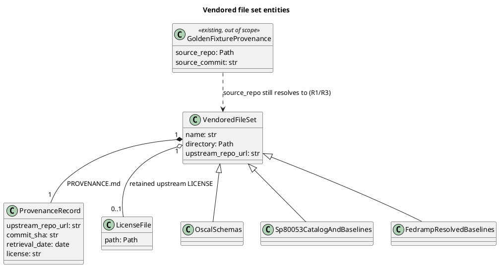
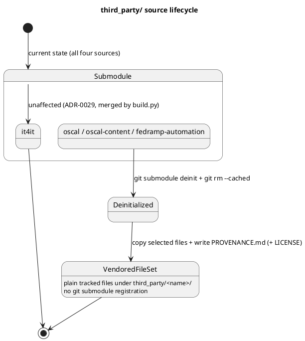

# Data Model: Vendor OSCAL/FedRAMP Files Instead of Submodules

## Entities

- **VendoredFileSet**: a named collection of plain, tracked files copied from one upstream
  repository into `third_party/<name>/`, replacing what used to be a git submodule. Three
  instances exist after this feature: `OscalSchemas` (`third_party/oscal`),
  `Sp80053CatalogAndBaselines` (`third_party/oscal-content`), and
  `FedrampResolvedBaselines` (`third_party/fedramp-automation`). `third_party/it4it` is not
  an instance of this entity — it remains a git submodule, out of scope (research R1, R8).
- **ProvenanceRecord**: the content of one `VendoredFileSet`'s `PROVENANCE.md` — upstream
  repository URL, the exact commit SHA the files were copied from, retrieval date, and
  license. Exactly one per `VendoredFileSet` (research R2).
- **LicenseFile**: the upstream `LICENSE`/`LICENSE.md` retained alongside a vendored set,
  because existing docs (`third_party/README.md`, `wiki/oscal-compliance.md`) cite it
  directly as the basis for the public-domain/CC0 license claims (research R5).
- **GoldenFixtureProvenance** (existing entity, not owned by this feature): the
  `source_repo`/`source_commit` fields in `tests/fixtures/golden-oscal/**/*.provenance.yaml`.
  Listed here only to record the relationship this feature must preserve: because
  `VendoredFileSet` keeps the same directory names and relative subpaths a submodule used
  (research R1), every existing `source_repo` value continues to resolve correctly without
  rewriting (research R3) — this feature's work on these files is verification, not a
  mechanical rename pass.

## Lifecycle

- `it4it` takes no transition in this feature — it stays a `Submodule` (ADR-0029).
- `oscal`, `oscal-content`, and `fedramp-automation` each move `Submodule → Deinitialized →
  VendoredFileSet` exactly once; there is no transition back, and no partial state is
  committed (removal and re-vendoring land together, per FR-001–FR-005).
