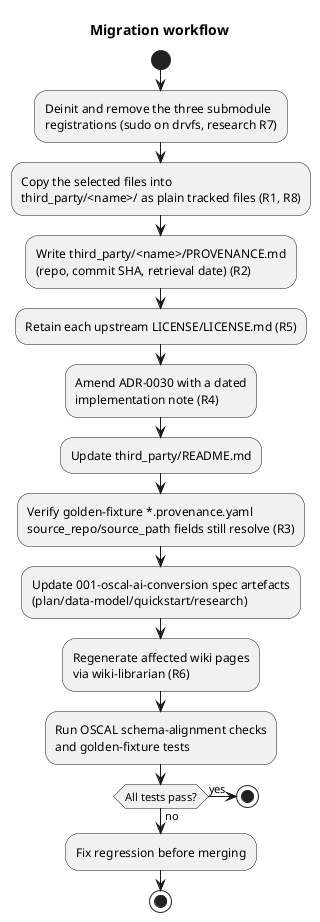
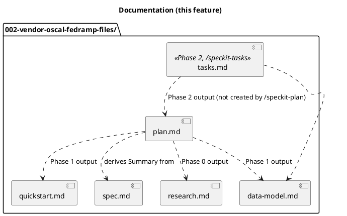
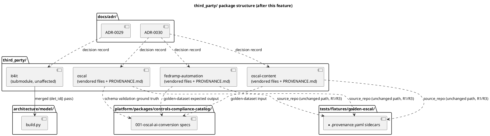

# Implementation Plan: Vendor OSCAL/FedRAMP Files Instead of Submodules

**Branch**: `feature/gh-167-vendor-oscal-fedramp-files` | **Date**: 2026-10-29 | **Spec**: [spec.md](spec.md)

**Input**: Feature specification from `platform/packages/controls-compliance-catalog/specs/002-vendor-oscal-fedramp-files/spec.md`

## Summary

Drop `third_party/oscal`, `third_party/oscal-content`, and `third_party/fedramp-automation`
as git submodules and replace each with a plain, tracked copy of only the files our tooling
actually reads — the NIST OSCAL schemas, the SP 800-53 rev5 catalog plus its four baseline
profiles, and the three FedRAMP resolved baseline catalogs (research R8) — each with its own
`PROVENANCE.md` and a retained upstream `LICENSE` file (research R2, R5). Because the
vendored sets keep their existing directory names and relative subpaths (research R1), every
other document that names a `third_party/` path (the golden-fixture provenance sidecars, the
`001-oscal-ai-conversion` spec artefacts) needs no mechanical rename — only ADR-0030, the
wiki pages it feeds, `third_party/README.md`, and the one stale `git submodule update --init`
instruction in `001-oscal-ai-conversion/quickstart.md` need an actual edit. `third_party/it4it`
is untouched throughout (ADR-0029, out of scope).

## Technical Context

**Language/Version**: N/A — this feature is a documentation and vendored-file migration;
no application code is added or changed.

**Primary Dependencies**: None new. Existing `pytest` suite (OSCAL schema-alignment checks,
`tests/fixtures/golden-oscal/` golden-fixture tests) is the verification mechanism.

**Storage**: Plain git-tracked files under `third_party/<name>/`; no database or runtime
storage involved.

**Testing**: `pytest` (existing OSCAL schema-alignment and golden-fixture tests, unchanged
in logic — see quickstart.md), plus a repository-wide grep check for stale submodule
references.

**Target Platform**: N/A — affects repository content and CI checkout behaviour only, not a
runtime target.

**Project Type**: Infrastructure/documentation migration within the existing `platform/`
Poetry monorepo and root governance docs; no new project or package.

**Performance Goals**: N/A.

**Constraints**: Must not break `actions/checkout`'s `submodules: true` step for the
remaining `it4it` submodule (research R9); must vendor only public-domain/CC0 content
consistent with this repo's AGPL-3.0 licensing, and must not pull in
`fedramp-automation`'s non-CC0 Go dependency surface (the license-baggage problem GH #167
raises) by vendoring only the named files, not the whole `GoComply/fedramp` tree.

**Scale/Scope**: Three vendored file sets, each a handful of files (OSCAL schemas; one
catalog + four baseline profiles; three resolved baseline catalogs), plus their
`PROVENANCE.md`/`LICENSE` files; one ADR amendment; four wiki pages (regenerated, not
hand-edited); one README; up to 13 golden-fixture provenance sidecars (verified, not
necessarily edited — research R3); four spec artefacts in `001-oscal-ai-conversion`.

## Constitution Check

*GATE: Must pass before Phase 0 research. Re-checked after Phase 1 design below.*

- **Principle VIII (Durability & Interoperability)** — PASS. The migration itself *is* the
  documented migration path this principle requires: each vendored set's `PROVENANCE.md`
  (research R2) preserves exactly the provenance trail ADR-0030 established, and research
  R5 keeps the upstream `LICENSE` file so the license basis stays citable, not just
  summarized.
- **Principle X (Decision Traceability & Documentation Integrity)** — PASS. The load-bearing
  choice (submodule → selective-file-vendoring) gets a dated implementation note amending
  ADR-0030 (research R4), landing in the same PR as the files it describes. **Model
  impact: none** — `architecture/model/` is untouched; none of `oscal`, `oscal-content`, or
  `fedramp-automation` is merged by `build.py` (unlike `it4it`, ADR-0029), so there is no
  element, relationship, or view to add, change, or retire.
- **Principle XI (Concise, Non-Duplicative Spec Artefacts)** — PASS. Facts are edited in
  their one owning artefact: `third_party/README.md` for the per-vendor narrative,
  `PROVENANCE.md` for per-set provenance, ADR-0030 for the decision, `001-oscal-ai-
  conversion`'s own artefacts for that package's usage instructions. `wiki/` is regenerated,
  never hand-edited (research R6). This plan embeds a component/package diagram (Project
  Structure, below) and an activity diagram (this section) rather than restating the
  migration as prose tables elsewhere.
- No other principle is implicated: no code, API, UI, state machine, or performance-
  sensitive path is touched.

## Project Structure

### Documentation (this feature)

No `contracts/` directory: this feature exposes no API, CLI, or other external interface —
it is a file-vendoring and documentation migration consumed only by other documents and
tests within this repository.

### Source Code (repository root)

**Structure Decision**: No new top-level directories. `third_party/oscal`,
`third_party/oscal-content`, and `third_party/fedramp-automation` change from submodule
gitlinks to ordinary tracked directories at the same paths (research R1); `third_party/it4it`
is unchanged. Touched files outside `third_party/` are existing documents edited in place:
`docs/adr/0030-vendor-oscal-reference-content.md`,
`platform/packages/controls-compliance-catalog/specs/001-oscal-ai-conversion/{plan,data-model,quickstart,research}.md`,
`tests/fixtures/golden-oscal/**/*.provenance.yaml` (verification pass), and four `wiki/`
pages (regenerated via `wiki-librarian`, never hand-edited).

## Complexity Tracking

*No Constitution Check violations — this section is intentionally empty.*
