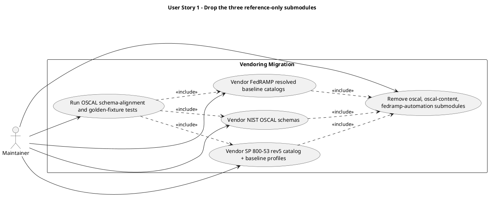
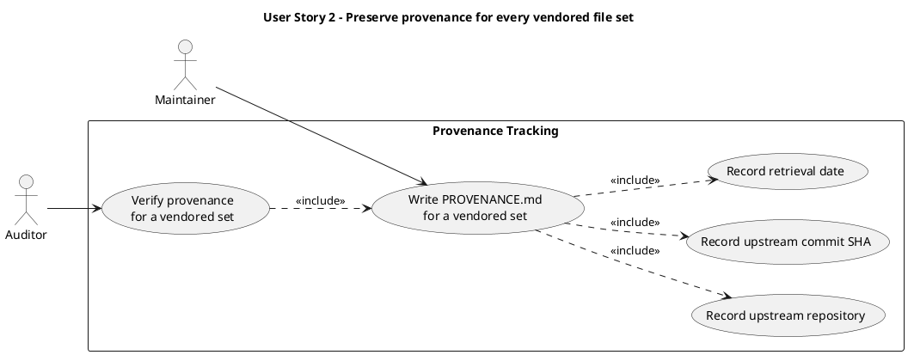
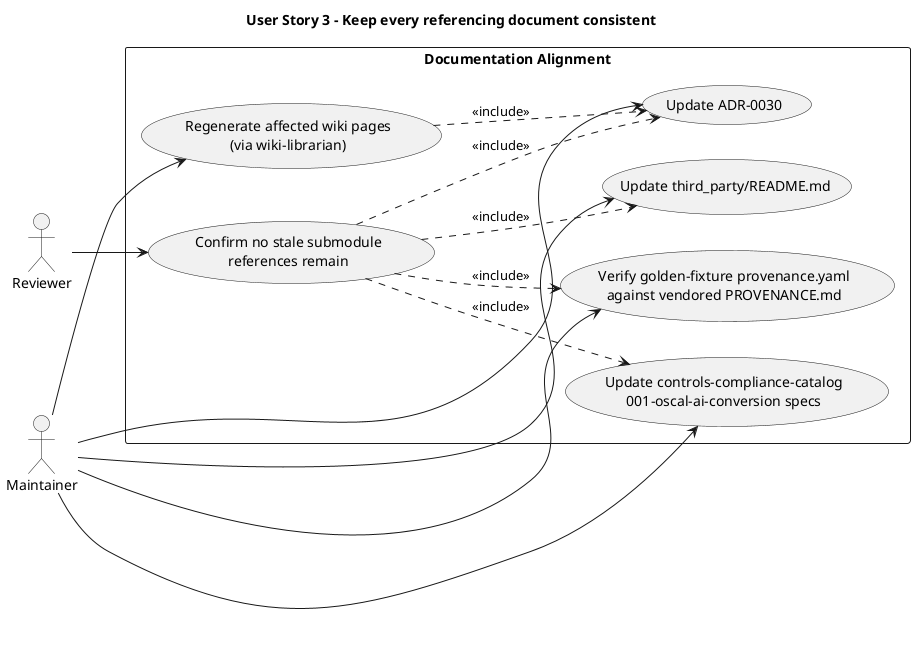

# Feature Specification: Vendor OSCAL/FedRAMP Files Instead of Submodules

**Feature Branch**: `feature/gh-167-vendor-oscal-fedramp-files`

**Created**: 2026-10-29

**Status**: Draft

**Input**: User description: "Replace oscal/oscal-content/fedramp-automation submodules with vendored file excerpts (GH #167): drop the `oscal`, `oscal-content`, and `fedramp-automation` git submodules under `third_party/` and replace them with plain vendored copies of only the files actually consumed — NIST OSCAL schemas (from usnistgov/OSCAL), the NIST SP 800-53 rev5 catalog plus LOW/MODERATE/HIGH/PRIVACY baseline profiles (from usnistgov/oscal-content), and the FedRAMP LOW/MODERATE/HIGH resolved baseline catalogs from GoComply/fedramp's bundled/catalogs/ (no PRIVACY baseline exists upstream). Each vendored set gets a PROVENANCE.md (upstream repo, commit SHA, retrieval date). Update ADR-0030 and its referencing wiki pages, .gitmodules, third_party/README.md, golden-fixture *.provenance.yaml source_repo fields, and the controls-compliance-catalog specs (001-oscal-ai-conversion/{plan,data-model,quickstart,research}.md) that assume a full submodule checkout. third_party/it4it stays a submodule (ADR-0029, actively merged by build.py) and is out of scope."

## User Scenarios & Testing *(mandatory)*

### User Story 1 - Drop the three reference-only submodules (Priority: P1)

As a maintainer, I want `oscal`, `oscal-content`, and `fedramp-automation` removed as git
submodules and replaced with plain vendored copies of only the files our tooling actually
reads, so that cloning and updating the repo no longer requires tracking and re-fetching
three large upstream repositories whose content (beyond a handful of files) we never use,
and so we stop inheriting `fedramp-automation`'s non-CC0 Go dependency license surface for
content we don't consume.

**Why this priority**: This is the core of the change — without it, nothing else in the
issue has a reason to exist. It also removes the most concrete pain (full submodule clones,
unwanted license surface) called out in GH #167.

**Independent Test**: Can be fully tested by running `git submodule status` and confirming
only `it4it` remains, then confirming the vendored files exist under `third_party/<name>/`
as plain tracked files (not gitlinks) and that existing OSCAL schema-validation and
golden-fixture tests still pass using those vendored files.

**Acceptance Scenarios**:

1. **Given** the repository currently vendors `oscal`, `oscal-content`, and
   `fedramp-automation` as git submodules, **When** this change is applied, **Then**
   `.gitmodules` and the repo's submodule configuration list only `it4it`.
2. **Given** the removed submodules, **When** a contributor clones the repository and runs
   `git submodule update --init`, **Then** no attempt is made to fetch `oscal`,
   `oscal-content`, or `fedramp-automation`, and the OSCAL schemas, the NIST SP 800-53 rev5
   catalog plus its LOW/MODERATE/HIGH/PRIVACY baseline profiles, and the FedRAMP
   LOW/MODERATE/HIGH resolved baseline catalogs are already present as vendored files.
3. **Given** the vendored files are in place, **When** the existing OSCAL schema-alignment
   checks and the golden-fixture tests under `tests/fixtures/golden-oscal/` are run,
   **Then** they pass without any change to test logic, reading the vendored paths instead
   of the former submodule checkouts.

---

### User Story 2 - Preserve provenance for every vendored file set (Priority: P1)

As a maintainer or auditor, I want every vendored set of files to carry a `PROVENANCE.md`
recording its upstream repository, the exact commit SHA it was taken from, and the retrieval
date, so that the traceability trail ADR-0030 established for these sources isn't lost when
they stop being submodules.

**Why this priority**: Without recorded provenance, vendored copies are indistinguishable
from arbitrary files with no upstream accountability — this is required at the same time as
User Story 1, not as a follow-up, to avoid ever landing untraceable vendored content.

**Independent Test**: Can be fully tested by confirming a `PROVENANCE.md` exists alongside
each of the three vendored file sets and that each one names its upstream repository, a
commit SHA, and a retrieval date.

**Acceptance Scenarios**:

1. **Given** the vendored NIST OSCAL schemas, **When** `PROVENANCE.md` for that set is
   read, **Then** it names `usnistgov/OSCAL`, a commit SHA, and a retrieval date.
2. **Given** the vendored NIST SP 800-53 rev5 catalog and baseline profiles, **When** its
   `PROVENANCE.md` is read, **Then** it names `usnistgov/oscal-content`, a commit SHA, and a
   retrieval date.
3. **Given** the vendored FedRAMP resolved baseline catalogs, **When** its `PROVENANCE.md`
   is read, **Then** it names `GoComply/fedramp`, a commit SHA, and a retrieval date, and
   notes that no PRIVACY baseline exists upstream.

---

### User Story 3 - Keep every referencing document consistent (Priority: P2)

As a maintainer or reviewer, I want ADR-0030, the wiki pages that cite it, `third_party/README.md`,
the golden-fixture provenance metadata, and the `controls-compliance-catalog` package's
`001-oscal-ai-conversion` spec artefacts to all describe the new vendored-file approach
instead of the old submodule checkout, so that nobody follows stale instructions (like
`git submodule update --init third_party/oscal-content`) that no longer do anything useful.

**Why this priority**: Important for keeping the documentation tree internally consistent
per the constitution's Principle X (one source of truth), but it does not block the
technical migration in User Stories 1 and 2 from being correct on its own.

**Independent Test**: Can be fully tested by grepping the tracked documentation tree for any
remaining reference to `oscal`, `oscal-content`, or `fedramp-automation` as a submodule (for
example, a `git submodule update --init` instruction naming one of them) and confirming
there are none outside of historical/changelog text, and by regenerating the wiki and
confirming the affected pages reflect the new approach.

**Acceptance Scenarios**:

1. **Given** ADR-0030 currently documents submodule-vendoring for all four `third_party/`
   sources, **When** this change is applied, **Then** ADR-0030 is updated (via an amendment
   or a new ADR superseding the relevant parts) to record that `oscal`, `oscal-content`, and
   `fedramp-automation` are now selectively vendored as plain files, with `it4it` unchanged.
2. **Given** `wiki/oscal-compliance.md`, `wiki/architecture.md`,
   `wiki/controls-compliance-catalog.md`, and `wiki/index.md` cite the old ADR-0030 decision,
   **When** the wiki is next regenerated, **Then** those pages reflect the updated decision.
3. **Given** `tests/fixtures/golden-oscal/**/*.provenance.yaml` files currently set
   `source_repo`/`source_commit` to the submodule's path and pinned commit, **When** this
   change is applied, **Then** those fields are verified against the matching vendored
   set's `PROVENANCE.md` and corrected if either no longer matches.
4. **Given** `platform/packages/controls-compliance-catalog/specs/001-oscal-ai-conversion/{plan,data-model,quickstart,research}.md`
   currently instruct readers to run `git submodule update --init third_party/oscal-content
   third_party/fedramp-automation`, **When** this change is applied, **Then** those
   instructions are replaced with a description of the vendored paths, each fact edited in
   its one owning artefact per Principle XI.

### Edge Cases

- What happens if an existing script or test still assumes `third_party/oscal-content` or
  `third_party/fedramp-automation` is a full upstream checkout (e.g. reads a file outside
  the vendored subset)? That usage must be found and either redirected to a vendored file or
  flagged as a gap, since the vendored sets intentionally hold only the files listed in User
  Stories 1 and 2.
- How does the system handle an upstream source that later changes (e.g. NIST publishes a
  new SP 800-53 revision)? The vendored copy is static and pinned by `PROVENANCE.md`;
  picking up an upstream change is a separate, deliberate re-vendoring action, not an
  automatic update.
- What happens to `third_party/it4it`? It is explicitly out of scope and must remain an
  unmodified git submodule, since `build.py` merges it into the architecture model
  (ADR-0029).
- What happens to the removed submodules' `.git/modules/` entries and any CI/tooling step
  that still runs `git submodule update --init` naming the dropped repositories? Those steps
  must be updated so they no longer reference removed submodules.

## Requirements *(mandatory)*

### Functional Requirements

- **FR-001**: The repository MUST drop `oscal`, `oscal-content`, and `fedramp-automation` as
  git submodules (removed from `.gitmodules` and submodule configuration), leaving `it4it` as
  the only tracked submodule under `third_party/`.
- **FR-002**: The repository MUST vendor, as plain tracked files (not gitlinks) under
  `third_party/`, the NIST OSCAL schema files (from `usnistgov/OSCAL`) needed as validation
  ground truth.
- **FR-003**: The repository MUST vendor, as plain tracked files, the NIST SP 800-53 rev5
  catalog and its LOW, MODERATE, HIGH, and PRIVACY baseline profiles (OSCAL JSON, from
  `usnistgov/oscal-content`).
- **FR-004**: The repository MUST vendor, as plain tracked files, the FedRAMP LOW, MODERATE,
  and HIGH resolved baseline catalogs from `GoComply/fedramp`'s `bundled/catalogs/` (no
  PRIVACY baseline, consistent with current upstream availability).
- **FR-005**: Each of the three vendored file sets MUST include a `PROVENANCE.md` recording
  its upstream repository, the commit SHA the files were retrieved from, and the retrieval
  date.
- **FR-006**: ADR-0030 MUST be updated to record the switch from submodule-vendoring to
  selective file-vendoring for `oscal`, `oscal-content`, and `fedramp-automation`, and the
  reason for it, while leaving the `it4it` decision unchanged.
- **FR-007**: `third_party/README.md` MUST be updated to remove submodule-update instructions
  for the three dropped repositories and describe the vendored paths and their provenance in
  their place.
- **FR-008**: The golden-fixture provenance files
  (`tests/fixtures/golden-oscal/**/*.provenance.yaml`) MUST have their `source_repo` and
  `source_commit` fields verified against the matching vendored set's own `PROVENANCE.md`
  (FR-005) — the commit SHA each one records is the one authoritative source — and
  corrected if any no longer matches.
- **FR-009**: The `controls-compliance-catalog` package's `001-oscal-ai-conversion` spec
  artefacts (`plan.md`, `data-model.md`, `quickstart.md`, `research.md`) MUST no longer
  instruct readers to run `git submodule update --init` for `oscal-content` or
  `fedramp-automation`, and MUST instead reference the vendored paths, with each fact edited
  in its single owning artefact.
- **FR-010**: Existing OSCAL schema-alignment checks and golden-fixture tests MUST continue
  to pass using the vendored files, with no change to test assertions beyond the paths or
  fixtures they read.
- **FR-011**: The wiki pages that cite the ADR-0030 submodule-vendoring decision
  (`wiki/oscal-compliance.md`, `wiki/architecture.md`, `wiki/controls-compliance-catalog.md`,
  `wiki/index.md`) MUST be regenerated (never hand-edited) so they reflect the updated
  decision.
- **FR-012**: `third_party/it4it` MUST remain an unmodified git submodule; this change MUST
  NOT alter its configuration or usage.

### Key Entities

- **Vendored file set**: A named, pinned snapshot of specific files from one upstream
  repository (OSCAL schemas, SP 800-53 rev5 catalog + baselines, or FedRAMP resolved
  baselines), stored as plain tracked files under `third_party/<name>/` with its own
  `PROVENANCE.md`.
- **PROVENANCE.md**: A per-vendored-set record of upstream repository URL, commit SHA, and
  retrieval date, establishing the traceability trail for that snapshot.
- **ADR-0030**: The decision record governing how `third_party/` content is vendored; this
  feature amends it to add selective file-vendoring alongside the unchanged submodule
  treatment of `it4it`.

## Success Criteria *(mandatory)*

### Measurable Outcomes

- **SC-001**: After this change, `git submodule status` lists exactly one submodule
  (`it4it`) under `third_party/`.
- **SC-002**: A fresh clone plus `git submodule update --init` no longer fetches the
  `oscal`, `oscal-content`, or `fedramp-automation` upstream repositories, while the
  specific files they used to provide remain available under `third_party/` as vendored
  copies.
- **SC-003**: 100% of existing tests that depend on OSCAL schemas, the SP 800-53 rev5
  golden fixtures, or FedRAMP baseline catalogs pass without any change to test logic.
- **SC-004**: Each of the three vendored file sets has a `PROVENANCE.md` naming an exact
  upstream commit SHA and retrieval date.
- **SC-005**: A repository-wide search finds no remaining instruction to
  `git submodule update --init` naming `oscal`, `oscal-content`, or `fedramp-automation`
  anywhere in tracked documentation or specs.

## Assumptions

- The set of files named in GH #167 (OSCAL schemas; the SP 800-53 rev5 catalog plus its
  four baseline profiles; the three FedRAMP resolved baseline catalogs) is sufficient for
  every current consumer. A broader audit of whether additional files are needed is called
  out as still-open follow-up work in the issue and is out of scope for this feature.
- `PROVENANCE.md` for each vendored set also records the upstream license, consistent with
  the provenance trail ADR-0030 already established, even though the issue's own wording
  only calls out repo/commit/date explicitly.
- `wiki/` pages are regenerated via the `wiki-librarian` skill rather than hand-edited, per
  the constitution's rule that the wiki is derived and never a source.
- `third_party/it4it` is unaffected by this feature and keeps its existing submodule
  treatment under ADR-0029.
