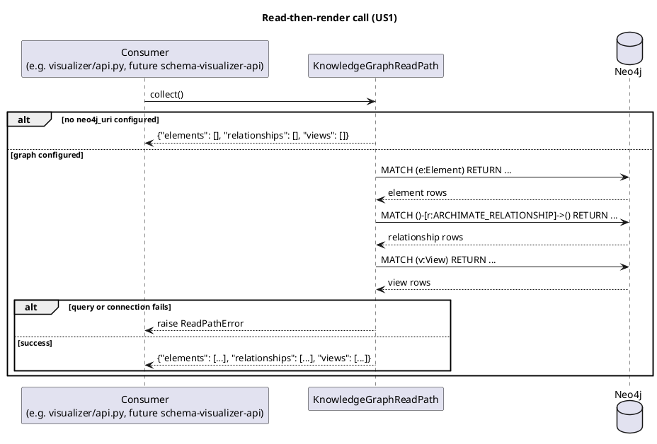

# Contract: Knowledge Graph Read Path (`if-twin-read-path`)

This package exposes an in-process Python interface, not a network contract — consumed as a
Poetry path dependency (FR-013, ADR-0005). "Contract" here means the public call shape every
consumer can rely on, detailed in `data-model.md`.

## Public surface

```python
from digital_twin_knowledge_graph import GraphSettings, KnowledgeGraphReadPath, ReadPathError
from digital_twin_knowledge_graph import SampleParser, SchemaManager

# Read path (FR-002, FR-003)
read_path = KnowledgeGraphReadPath(settings: GraphSettings)
read_path.collect() -> dict[str, list[dict[str, Any]]]  # keys: elements, relationships, views
read_path.close() -> None

# Parser (FR-004, FR-005) — no graph connection involved
parser = SampleParser(sample_file: Path)
parser.parse() -> ParsedSample  # .elements, .relationships, .views, .warnings

# Schema manager (FR-006, FR-007, FR-008, FR-009, FR-010)
manager = SchemaManager(uri: str, user: str, password: str)
manager.apply_constraints() -> None
manager.ingest(payload: Mapping[str, Sequence[Mapping[str, Any]]]) -> None
manager.run_audit_checks() -> tuple[list[dict], list[dict]]
manager.record_schema_version(name: str) -> None
manager.close() -> None
```

## Error contract

- `KnowledgeGraphReadPath.collect()` never raises a `neo4j` driver/`Neo4jError` type to the
  caller — only `ReadPathError`, with the original exception chained (`raise ... from exc`)
  for diagnostics.
- `SampleParser.parse()` raises `FileNotFoundError`, `xml.etree.ElementTree.ParseError`,
  `ValueError` (no root element) or `ArchimateNamespaceError` (wrong namespace) — all
  standard-library or this package's own types, never a partially-populated `ParsedSample`.
- `SchemaManager.ingest()` raises `ValueError` naming the missing endpoint(s) when a
  relationship's `source`/`target` doesn't exist (FR-007); no other failure mode writes
  partial state for that relationship.

## Sequence: a consumer's read-then-render call



## Consumer compatibility note

Today's only real consumer (flat-`src/`'s `visualizer/api.py`) does not import this package in
this increment (plan.md Summary) — this contract documents the shape a future consumer
(`schema-visualizer-api`, or an earlier opt-in from the flat app) will call, built and tested
now against that exact shape.
