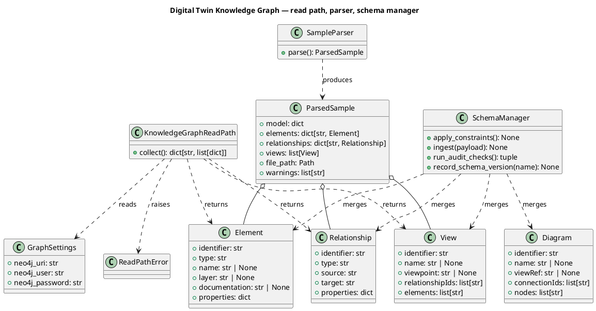

# Phase 1 Data Model: Digital Twin Knowledge Graph — Read Path

Entities below map directly to the spec's "Key Entities" section. The graph-stored entities
(`Element`, `Relationship`, `View`, `Diagram`) already exist in Neo4j today, built by
flat-`src/`'s `schema/manager.py`; this package reads and ingests the same shapes, unchanged.

## Element

- `identifier: str` — unique within the graph (Neo4j `UNIQUE` constraint).
- `type: str` — ArchiMate element type (e.g. `BusinessActor`, `ApplicationComponent`).
- `name: str | None`
- `layer: str | None` — ArchiMate layer, including the ported business/motivation-layer
  vocabulary (FR-010, research.md R4).
- `documentation: str | None`
- `properties: dict[str, Any]` — free-form, merged onto the node.

## Relationship

- `identifier: str` — unique within the graph.
- `type: str`
- `source: str` / `target: str` — `Element` identifiers.
- `properties: dict[str, Any]`
- **Rule**: exists only as a graph edge, never a dangling reference — ingesting a
  relationship whose `source` or `target` identifier has no matching `Element` fails with an
  error naming which endpoint(s) are missing (FR-007), and the edge is never created.

## View

- `identifier: str` — unique within the graph.
- `name: str | None`, `viewpoint: str | None`, `viewpointRef: str | None`
- `relationshipIds: list[str]` — a plain string list, **not** graph edges; can reference an
  identifier with no matching `Relationship` edge, which the integrity audit (FR-008) finds.
- `elements: list[str]` — `Element` identifiers the view includes (`INCLUDES` edges once
  ingested).
- `nodes` / `connections` — layout (bounds, element/relationship refs); present only on a
  `Parsed Sample`'s views, not separately persisted in the graph.

## Diagram

- `identifier: str` — unique within the graph.
- `name: str | None`, `viewRef: str | None` (`REPRESENTS_VIEW` edge target), `viewpoint: str | None`
- `connectionIds: list[str]` — a plain string list, same "can reference a non-existent edge"
  risk as `View.relationshipIds`, audited the same way (FR-008).
- `nodes: list[str]` — `Element` identifiers (`HAS_NODE` edges).

## Parsed Sample

- `model: dict[str, Any]` — the parsed file's own identifier/name.
- `elements: dict[str, Element]` / `relationships: dict[str, Relationship]` — keyed by
  identifier.
- `views: list[View]` — with layout.
- `file_path: Path`
- `warnings: list[str]`
- **Rule**: a duplicate element, relationship or view identifier in the source file keeps the
  last definition and appends a warning — never a silent overwrite, never a hard failure
  (FR-005).

## Graph Settings

- `neo4j_uri: str` (empty means "no connection configured"), `neo4j_user: str`,
  `neo4j_password: str`.
- Read from `FRICTIONLESS_ARCHITECT_*` environment variables (research.md R6) — the same
  prefix flat-`src/`'s `VisualizerSettings` already uses, so one Neo4j connection is
  configured once, not twice.

## Knowledge Graph Read Path (`if-twin-read-path`)

- One method, `collect() -> dict[str, list[dict[str, Any]]]`, keyed `"elements"` /
  `"relationships"` / `"views"`.
- **Rule**: no graph connection configured → returns empty lists for all three keys, not an
  error (FR-003). Graph unreachable or a query fails → raises `ReadPathError`, never a raw
  `neo4j` driver exception (FR-002/FR-003).

## Schema Manager

- `apply_constraints()` — creates the uniqueness constraints and indexes listed below;
  idempotent (`IF NOT EXISTS`).
- `ingest(payload)` — merges `elements` / `relationships` / `views` / `diagrams` into the
  graph; idempotent (`MERGE`), so ingesting the same payload twice leaves node/edge counts
  unchanged (FR-006, SC-004). Carries the ported batched (`UNWIND`-style) ingestion idea
  (FR-010, research.md R4).
- `run_audit_checks() -> tuple[list[dict], list[dict]]` — `(missing_relationship_targets,
  orphan_views)` (FR-008).
- `record_schema_version(name)` — stamps a timestamped `SchemaVersion` node (FR-009).

### Constraints & indexes (unchanged from today's `schema/manager.py`)

| Kind | On | Purpose |
|---|---|---|
| Uniqueness constraint | `Element.identifier`, `View.identifier`, `Diagram.identifier`, `Viewpoint.identifier`, `SchemaVersion.name` | No duplicate nodes of the same kind. |
| Index | `Element.type`, `Element.layer`, `ARCHIMATE_RELATIONSHIP.identifier`, `ARCHIMATE_RELATIONSHIP.type`, `View.name`, `Diagram.name` | Query performance for the read path and audits. |

## Class diagram

