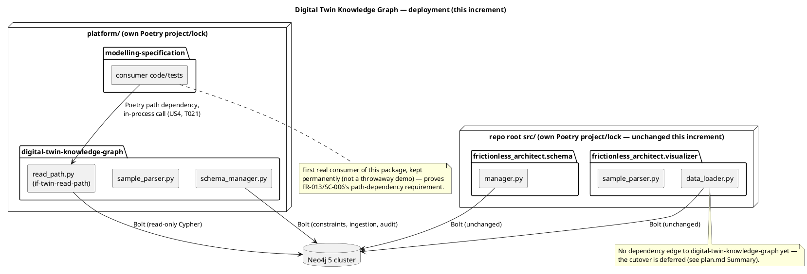

# Implementation Plan: Digital Twin Knowledge Graph — Read Path

**Branch**: `001-knowledge-graph-read-path` | **Date**: 2026-10-12 | **Spec**: [spec.md](spec.md)

**Input**: Feature specification from
`platform/packages/digital-twin-knowledge-graph/specs/001-knowledge-graph-read-path/spec.md`

## Summary

Scaffold `platform/packages/digital-twin-knowledge-graph` (GH #106, `ARCHITECTURE.md`
migration step 4) as its own Poetry package, and build its narrow, in-process read path
(`if-twin-read-path`) over Neo4j — free of leaked driver types — plus an ArchiMate exchange
parser and an idempotent schema/ingestion manager. All three are built fresh in this
package, using today's flat-`src/` `visualizer/data_loader.py`, `visualizer/sample_parser.py`
and `schema/manager.py` as the proven reference behavior (same inputs, outputs, edge cases,
and test cases), and deliberately porting the ArchiMate business/motivation-layer vocabulary
and batched (`UNWIND`-style) ingestion idea from the retired `prototype-neo4j` reference
(ADR-0006) — never by restoring its files.

**Scope boundary** (resolved during planning, not by the spec alone): this feature does
**not** cut `visualizer/api.py` or `scripts/neo4j_schema.py` over to the new package, and does
not touch flat-`src/`'s copies of the three modules. The repo root and `platform/` are
separate Poetry projects with separate lockfiles (`ARCHITECTURE.md` §8 Status; root
`pyproject.toml` excludes `platform/`), and no ADR yet describes a root-depends-on-
`platform/packages/*` path-dependency mechanism. Establishing one is its own decision,
deferred to the visualiser API/UI split (`ARCHITECTURE.md` §8.2, step 7) or a dedicated
follow-up — see spec.md Assumptions.

**A second scope boundary** (model alignment, spec.md "Scope boundary" section): `sub-twin`
models two planes — the **intent plane** (the ArchiMate graph this package reads/ingests)
and a **current-state twin plane** (`fn-twin-ingest`, built from live infrastructure state
and deployment events). This increment implements the intent plane only. `fn-twin-ingest`
and `fn-ledger-record` are both out of scope — see spec.md Assumptions for why each is
excluded rather than silently omitted.

**A third scope boundary** (same section): even within the intent plane, `architecture/
model/README.md` and ADR-0007 name two distinct ingestion paths into Neo4j — Exchange-XML
files via `SampleParser` (what this package implements, User Story 2) and a `[later]`,
not-yet-built "Neo4j seed" that reads `architecture/model/`'s own canonical YAML directly,
skipping the Exchange-XML parser. This package implements only the first; the direct-YAML
seed is a future increment against the same `SchemaManager.ingest()` surface.

## Technical Context

**Language/Version**: Python 3.12 (package floor `>=3.11,<3.14`, matching `platform/pyproject.toml`).

**Primary Dependencies**: `neo4j` 5.x driver, `defusedxml` (sample parsing), `pydantic` +
`pydantic-settings` v2 (connection settings, R6) — each declared in this package's own
`pyproject.toml` (ADR-0002: own dependencies, one shared `platform/poetry.lock`). No FastAPI
or other web framework — this is a library, not a service (FR-013).

**Storage**: Neo4j 5 cluster (external; same connection shape flat-`src/` already uses — no
new infrastructure).

**Testing**: `pytest`, under `tests/unit/` (mirrors `src/digital_twin_knowledge_graph/` per
`TECHNICAL.md` Testing Layout) and `tests/integration/` for the one test that needs a real
Neo4j instance. Test *cases* are carried over from the existing flat-`src/` test files
(`tests/unit/visualizer/test_data_loader.py`, `tests/unit/visualizer/test_sample_parser.py`,
`tests/unit/schema/test_manager.py`, `tests/integration/test_schema_manager_audit.py`) and
re-targeted at this package's modules — the flat-`src/` test files themselves are untouched
(FR-011). `scripts/platform_checks.sh` gates pyright, mypy and pytest at 90% coverage.

**Target Platform**: Linux server / dev workstation (same as today).

**Project Type**: Monorepo package — `platform/packages/digital-twin-knowledge-graph`
(subsystem 3, `ARCHITECTURE.md` §4) — a library with no app or router of its own.

**Performance Goals**: Read-path queries meet `NONFUNCTIONALS.md`'s "API common queries <1s"
bar — the same target flat-`src/`'s equivalent code already meets; this package introduces no
new target.

**Constraints**: No Neo4j driver, session or record type in the public interface (FR-002);
ingestion MUST be idempotent (FR-006); no cutover of the flat-`src/` callers in this increment
(see Summary's scope boundary).

**Scale/Scope**: Single-user, local MVP (ADR-0024). Reference scale is the canonical sample
model's load-bearing subset (ADR-0006 — roughly 30 nodes); this feature introduces no
multi-tenant or multi-graph requirement.

## Constitution Check

*GATE: Must pass before Phase 0 research. Re-checked after Phase 1 design below.*

| Principle | Assessment |
|---|---|
| I. Code Quality | New modules keep the existing module-per-concern boundary (read path / parser / schema manager), matching flat-`src/`'s own layout. No violation. |
| II. Testing Standards | Ported test cases (FR-011/SC-003) exercise the same behavior the flat-`src/` tests already proved; 90% coverage carried by `scripts/platform_checks.sh`. No violation. |
| III. UX Consistency | Not applicable — no new CLI/API surface; this is a library, and its only "interface" is the Python call contract in `contracts/read-path.md`. |
| IV. Performance | Read-path queries meet the existing `NONFUNCTIONALS.md` <1s common-query bar; no new target. No violation. |
| V. Security | No new secrets. Neo4j credentials continue to come from environment variables under the same `FRICTIONLESS_ARCHITECT_` prefix flat-`src/` already uses (R6), so operators configure one Neo4j connection, not two. No violation. |
| VI. State Management | No governed-lifecycle entity is introduced; graph data is not a workflow entity with defined states. Not applicable. |
| VII. System Integrity & Accuracy | Relationship referential-integrity checks (FR-007) and the integrity audit queries (FR-008) are carried over unchanged — the principle's "automated consistency checks" requirement is already met by the ported code. No violation. |
| VIII. Durability & Interoperability | ArchiMate Exchange Format parsing semantics are preserved verbatim (FR-005, SC-003); ported `prototype-neo4j` ideas are attributed to ADR-0006, not silently absorbed. No violation. |
| IX. Cross-Platform Consistency | Pure backend library; no UI or platform-specific behavior. Not applicable. |
| X. Decision Traceability | Model impact: **none** — `sub-twin`, `if-twin-read-path`, `art-pkg-digital-twin-knowledge-graph`, `wp-106-scaffold-twin` and `cap-digital-twin` already exist in `architecture/model/` and anticipate exactly this work; this plan implements against them without adding, changing or retiring any id. This plan deliberately implements only half of `sub-twin`'s modelled functions (`if-twin-read-path`'s intent-plane read/ingest path); `fn-twin-ingest` (twin-plane ingestion from live infrastructure/deployment data) and `fn-ledger-record` (forensic ledger) are out of scope and explicitly named as such in spec.md's Assumptions, not silently dropped — Principle VII's "faithfully reflect reality" is satisfied by that explicit exclusion, not by this increment covering the whole subsystem. One open item, flagged rather than resolved here: `art-pkg-digital-twin-knowledge-graph` was aggregated only into the `plat-multi-user-collaboration-2` plateau (a later, GitHub-milestone-derived plateau, ADR-0035) when this was first checked, with GH #106 carrying no milestone at that time; #106 has since been assigned milestone #7 ("architecture-strategy-mvp") — whether that milestone already has a corresponding `plat-*`/`gap-*` edge, making the open item moot, has not been re-checked. Still a roadmap-bookkeeping question for the maintainer, not something this plan decides. |
| XI. Concise, Non-Duplicative Spec Artefacts | This plan links to `data-model.md`/`research.md`/`contracts/` rather than repeating their content. |

**Gate result**: PASS. No Complexity Tracking entries — see below.

**Post-design re-check** (after Phase 0/1 below): Unchanged. Research (R1–R7) and design
(`data-model.md`, `contracts/read-path.md`) introduced no new dependency, state machine, or
network surface beyond what this table already assessed — PASS stands.

## Project Structure

### Documentation (this feature)

```plantuml
@startuml
package "specs/001-knowledge-graph-read-path/" {
  [plan.md] as plan
  [research.md] as research
  [data-model.md] as data_model
  [quickstart.md] as quickstart
  package "contracts/" {
    [read-path.md] as contract
  }
  [tasks.md] as tasks
}
plan ..> research : Phase 0
plan ..> data_model : Phase 1
plan ..> contract : Phase 1
plan ..> quickstart : Phase 1
plan ..> tasks : Phase 2\n(/speckit-tasks — not\ncreated by this command)
note right of tasks
  Not yet created — see
  plan.md Where We're Going
end note
@enduml
```

### Source Code (`platform/packages/digital-twin-knowledge-graph/`)

```plantuml
@startuml
package "src/digital_twin_knowledge_graph/" {
  [__init__.py\npublic exports] as init
  [config.py\nGraphSettings (R6)] as config
  [namespaces.py\nARCHIMATE_NS, XSI_NS\nrequire_archimate_namespace\n(ported, US2)] as namespaces
  [sample_parser.py\nSampleParser, SampleParseResult\n(ported, US2)] as parser
  [read_path.py\nif-twin-read-path:\nKnowledgeGraphReadPath, ReadPathError\n(ported from data_loader.py, US1)] as read_path
  [schema_manager.py\nconstraints/indexes/ingestion/audit\n(ported business/motivation vocabulary +\nbatched ingestion, FR-010, US3)] as schema_manager
}

init ..> read_path
init ..> parser
init ..> schema_manager
read_path ..> config
schema_manager ..> config
parser ..> namespaces

package "tests/" {
  package "unit/" {
    [test_read_path.py]
    [test_sample_parser.py]
    [test_namespaces.py]
    [test_schema_manager.py]
  }
  package "integration/" {
    [test_schema_manager_audit.py]
  }
}
@enduml
```

Both diagrams show the same module set as before; the documentation-tree trees above are not
restated in prose elsewhere in this plan.

### Deployment diagram

Shows this increment's actual boundary: the new package depends only on Neo4j; flat-`src/`
keeps its own, unchanged copies and is not yet a consumer (Summary's scope boundary).



**Structure Decision**: New code only, written straight into
`platform/packages/digital-twin-knowledge-graph` (no flat-`src/` move this increment — see
Summary). The package has no FastAPI app of its own; it is called as an ordinary Python
import, matching `if-twin-read-path`'s "path-dependency library" description (ADR-0005). Its
own dependency is Neo4j only — no other `platform/packages/*` package, and no dependency in
the other direction from the repo root. `modelling-specification` adds this package as its own
path dependency (US4/FR-013/SC-006's required demonstration, tasks.md T021) and is kept, not
reverted, making it this package's first real consumer — the deployment diagram below shows
that edge.

## Complexity Tracking

*No unjustified Constitution violations — see Constitution Check above.*

| Violation | Why Needed | Simpler Alternative Rejected Because |
|---|---|---|
| — | — | — |
