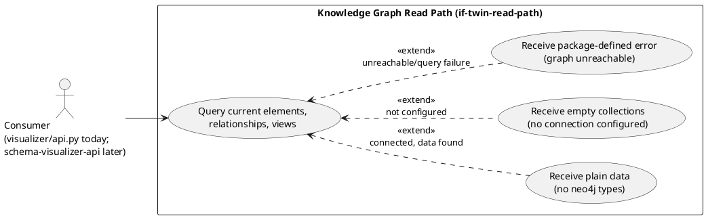
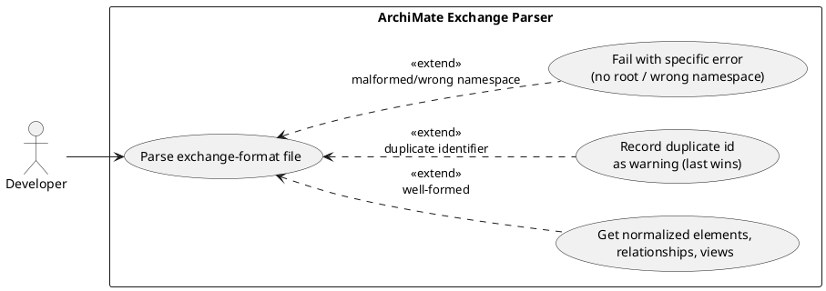
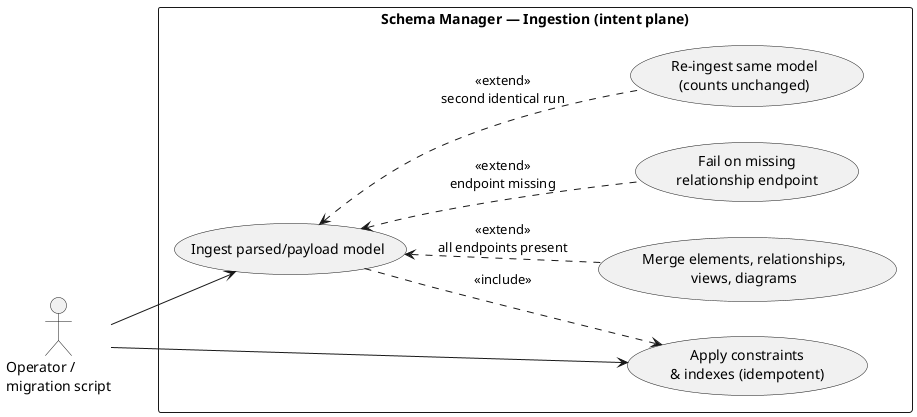
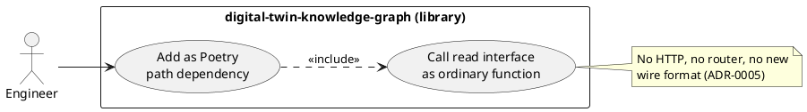
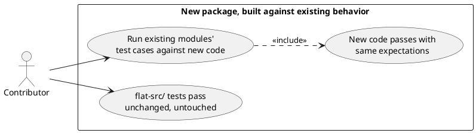

# Feature Specification: Digital Twin Knowledge Graph — Read Path

**Feature Branch**: `feature/gh-106-digital-twin-knowledge-graph`

**Created**: 2026-10-12

**Status**: Draft

**Input**: User description: "Scaffold `platform/packages/digital-twin-knowledge-graph` per GH issue #106 (ADR-0006, `ARCHITECTURE.md` migration step 4): create the package (`pyproject.toml`, `src/`, `tests/`, `README.md`, `specs/`), port the relevant ideas from the retired `prototype-neo4j` spike deliberately into the new structure rather than merging it wholesale, and implement the narrow `if-twin-read-path` interface already described in `architecture/model/` (Knowledge Graph Read Path) so that `schema-visualizer-api` can later consume it as a path dependency, free of leaked Neo4j driver types."

Decision records: [ADR-0005](../../../../../docs/adr/0005-visualiser-api-ui-split-first-extraction.md)
(scope and sequencing), [ADR-0006](../../../../../docs/adr/0006-prototype-neo4j-reference-only.md)
(`prototype-neo4j` is a reference, not a merge source), [ADR-0007](../../../../../docs/adr/0007-architecture-model-as-graph-loadable-yaml.md)
(the canonical YAML's `[later]` direct-to-Neo4j seed path, left for a future increment — see
"Scope boundary" and Assumptions), [ADR-0017](../../../../../docs/adr/0017-knowledge-graph-on-standard-ontology.md)
(ontology, left open — see Assumptions). GH issue [#106](https://github.com/wolffy-au/frictionless-architect/issues/106).

## Scope boundary: intent plane only, not the twin plane

`sub-twin` ("Digital Twin & Knowledge Graph") is modelled with two planes: an **intent
plane** (the ArchiMate architecture model itself — elements, relationships, views) and a
**current-state twin plane** (built by `fn-twin-ingest` from live infrastructure state and
deployment events, `do-infra-state`/`do-deploy-event` → `do-twin`). This spec covers **only
the intent plane**: `if-twin-read-path` reads and `SchemaManager` ingests the ArchiMate
graph, exactly matching what today's flat-`src/` `data_loader.py`/`sample_parser.py`/
`schema/manager.py` already do. `fn-twin-ingest` (current-state twin ingestion from live
infrastructure/deployment data) and `fn-ledger-record` (forensic ledger) are both out of
scope for this increment — see Assumptions for why each is excluded.

Within the intent plane itself, this increment covers only **one** of two ingestion paths
`architecture/model/README.md` and ADR-0007 anticipate: ArchiMate Exchange Format files in,
via `SampleParser` (today's flat-`src/` behavior, User Story 2). ADR-0007's own diagram names
a second, `[later]` path — a "Neo4j seed" that reads `architecture/model/`'s own canonical
YAML (`elements.yaml`/`relationships.yaml`/`views.yaml`) **directly**, bypassing the
Exchange-XML parser entirely. No code anywhere reads `architecture/model/` into Neo4j today;
that seed is out of scope here too — see Assumptions. (This is a payload-shape exclusion, not
an authority-direction one: the separate question of *which store is authoritative* past a
scale ceiling is `gap-yaml-to-neo4j-authoritative`, ADR-0007's 2026-10-18 update — orthogonal
to this exclusion, not a cross-reference this spec needs to act on.)

## User Scenarios & Testing *(mandatory)*

### User Story 1 - Query the knowledge graph without touching Neo4j directly (Priority: P1)

A developer building a consuming package (today's flat visualiser; `schema-visualizer-api`
once extracted, ARCHITECTURE.md §8.2) needs the current elements, relationships and views of
the Architecture Knowledge Graph to render or serve them, without importing the `neo4j`
driver or writing Cypher themselves.

**Why this priority**: This is the interface the model already names (`if-twin-read-path` /
"Knowledge Graph Read Path") and the one piece every other migration step downstream is
blocked on (ADR-0005). Nothing else in this package matters if this doesn't exist.

**Independent Test**: Call the package's read interface against a populated graph and confirm
it returns elements, relationships and views as plain data, with no `neo4j` driver, session or
record type anywhere in the call or its result.

**Acceptance Scenarios**:

1. **Given** a configured, reachable graph with data, **When** the read interface is called,
   **Then** it returns the current elements, relationships and views.
2. **Given** no graph connection is configured, **When** the read interface is called, **Then**
   it returns empty collections rather than an error.
3. **Given** the graph is unreachable or a query fails, **When** the read interface is called,
   **Then** it raises a package-defined error, never a raw `neo4j` driver exception.

---

### User Story 2 - Parse an ArchiMate exchange file independently of the graph (Priority: P1)

A developer needs to turn an ArchiMate 3 Exchange Format file (the canonical sample model,
or another exported model) into a normalized, in-memory set of elements, relationships and
views, usable for ingestion, comparison or offline rendering, without a live graph connection.

**Why this priority**: The read path's visualiser consumer merges live-graph data with parsed
sample data today; losing this breaks that merge. It is also the input side of ingestion
(User Story 3).

**Independent Test**: Parse a known-good sample file and confirm the normalized elements,
relationships and views match the file's content; parse a malformed or wrong-namespace file
and confirm it fails with a specific error instead of a generic one.

**Acceptance Scenarios**:

1. **Given** a well-formed ArchiMate 3 exchange file, **When** it is parsed, **Then** its
   elements, relationships and views are returned normalized by identifier.
2. **Given** a file with a duplicate element, relationship or view identifier, **When** it is
   parsed, **Then** the last definition is kept and the duplicate is recorded as a warning, not
   a failure.
3. **Given** a file with no root element or the wrong ArchiMate namespace, **When** it is
   parsed, **Then** parsing fails with an error naming the specific problem.

---

### User Story 3 - Ingest a model into the graph idempotently (Priority: P2)

An operator or migration script needs to merge a parsed or payload-supplied model into the
graph store — creating or updating elements, relationships, views and diagrams — such that
running the same ingestion again leaves the graph unchanged rather than duplicating data.

**Why this priority**: Required to populate and evolve the graph at all, but the read path
(User Story 1) can be demonstrated against a graph seeded by hand first; this is needed before
the package is useful end-to-end.

**Independent Test**: Ingest a sample model twice in a row and confirm the graph's node and
edge counts after the second run equal the counts after the first.

**Acceptance Scenarios**:

1. **Given** a parsed model, **When** it is ingested, **Then** its elements, relationships,
   views and diagrams are merged into the graph, creating uniqueness constraints and indexes
   first if they do not already exist.
2. **Given** a relationship whose source or target identifier is not present in the graph,
   **When** it is ingested, **Then** ingestion fails with an error naming which endpoint(s) are
   missing, rather than creating a dangling edge.
3. **Given** the same model ingested twice, **When** the graph is inspected after each run,
   **Then** the node and edge counts are identical.

---

### User Story 4 - Depend on the package as an in-process library, not a service (Priority: P2)

An engineer adding a consumer of the knowledge graph wants to add this package as an ordinary
Poetry path dependency and call it directly, without standing up a new HTTP endpoint, API
contract, or network boundary for this read path.

**Why this priority**: This is the sequencing decision ADR-0005 records — a second consumer
could force a service boundary later, but today's single consumer should not pay that cost.

**Independent Test**: Add the package as a path dependency from another `platform/packages/*`
package and call its read interface directly, with no new router, port, or wire format
introduced.

**Acceptance Scenarios**:

1. **Given** another package in the `platform/` workspace, **When** it adds this package as a
   path dependency, **Then** it can call the read interface as an ordinary function call.

---

### User Story 5 - Build the new package's code equivalent to today's flat-`src/` behavior (Priority: P2)

A contributor implementing this package's read path, sample parser and schema manager uses
today's flat `src/frictionless_architect/schema/manager.py`,
`visualizer/data_loader.py` and `visualizer/sample_parser.py` as the reference behavior — same
inputs, same outputs, same edge cases — without needing the flat-`src/` originals deleted or
their existing callers (`visualizer/api.py`, `scripts/neo4j_schema.py`) repointed in this
increment.

**Why this priority**: This is how the package gets built with confidence — against proven,
already-tested behavior — without taking on the flat-`src/` cutover (a separate, larger change;
see Assumptions) as part of standing the package up.

**Independent Test**: Run the new package's test suite, built from the existing modules' test
cases, against the new package's code; it passes with the same assertions those existing tests
already make, with no change to flat-`src/`'s own code or tests.

**Acceptance Scenarios**:

1. **Given** the new package's read path, parser and schema manager, **When** the existing
   modules' test cases are run against them, **Then** they pass with the same expectations.
2. **Given** the flat-`src/` tree is left untouched by this feature, **When** its existing
   tests run, **Then** they pass exactly as before, with no change in behavior or imports.

---

### Edge Cases

- No graph connection configured: the read path returns empty collections, not an error
  (preserves today's behavior for offline/cache-only use).
- Graph unreachable or a query fails: a package-defined error is raised, never a raw `neo4j`
  driver or `Neo4jError` type.
- A view or diagram references a relationship identifier with no matching graph edge: caught
  by an integrity audit check, not a crash at parse or ingest time.
- Re-running constraint/index setup against an already-provisioned graph is a no-op, not an
  error.
- A parsed sample's duplicate identifiers are last-definition-wins plus a recorded warning,
  never a silent overwrite and never a hard failure.

## Requirements *(mandatory)*

### Functional Requirements

- **FR-001**: The system MUST exist as its own installable package at
  `platform/packages/digital-twin-knowledge-graph` (own `pyproject.toml`, `src/`, `tests/`,
  `README.md`, `specs/`), added to the `platform/` Poetry workspace.
- **FR-002**: The system MUST expose a narrow, in-process read interface (the model's
  `if-twin-read-path`) returning the knowledge graph's elements, relationships and views as
  plain data; no Neo4j driver, session or record type MUST appear in that interface's
  parameters or return types.
- **FR-003**: The read interface MUST return empty collections when no graph connection is
  configured, and MUST raise a package-defined error — never a raw Neo4j driver exception —
  when the graph is unreachable or a query fails.
- **FR-004**: The system MUST provide an ArchiMate 3 Exchange Format parser that normalizes a
  model file into elements, relationships and views in memory, independent of any graph
  connection.
- **FR-005**: The parser MUST reject a file with no root element or the wrong ArchiMate
  namespace with an error naming the specific problem, and MUST record — not fail on —
  duplicate element, relationship or view identifiers, keeping the last definition.
- **FR-006**: The system MUST provide an idempotent ingestion path that merges a parsed or
  payload-supplied model (elements, relationships, views, diagrams) into the graph store,
  applying uniqueness constraints and indexes before first use.
- **FR-007**: Ingesting a relationship whose source or target identifier is not present in the
  graph MUST fail with an error naming which endpoint(s) are missing, rather than silently
  creating a dangling edge.
- **FR-008**: The system MUST provide integrity audit checks that find view/diagram
  relationship references with no matching graph edge, and views with no included elements or
  no relationship references.
- **FR-009**: The system MUST be able to record a timestamped schema-version marker on demand,
  so the graph's applied schema state can be queried later.
- **FR-010**: The system MUST deliberately port the ArchiMate business/motivation layer
  vocabulary and the batched (`UNWIND`-style) ingestion approach from the retired
  `prototype-neo4j` reference (ADR-0006) into this package's own code and tests — never by
  merging that branch's history or files wholesale.
- **FR-011**: The system MUST implement its read path, sample parser and schema manager as new
  modules in this package, behaviorally equivalent to today's flat-`src/`
  `schema/manager.py`, `visualizer/data_loader.py` and `visualizer/sample_parser.py` (same
  inputs, outputs and edge cases), built and tested against those modules' existing test
  cases.
- **FR-012**: Repointing the flat `src/frictionless_architect/visualizer/api.py` and
  `scripts/neo4j_schema.py` (today's callers of the equivalent flat-`src/` modules) onto this
  package, and retiring the flat-`src/` originals, is OUT OF SCOPE for this increment — see
  Assumptions.
- **FR-013**: The system MUST be consumable as a Poetry path dependency — an in-process
  library call — not over HTTP, until a second consumer needs a service boundary (ADR-0005).
- **FR-014**: The package's public read, parse and ingest surface MUST meet the 90%
  line-coverage gate `scripts/platform_checks.sh` already enforces for `platform/packages/*`.
- **FR-015**: The system MUST preserve today's ArchiMate-typed element/relationship vocabulary
  (ADR-0008) as its working ontology for this increment; reconciling it with a standardized
  ontology (Backstage Software Catalog or C4, ADR-0017) is deferred and out of scope here.

### Key Entities

- **Element**: An ArchiMate element (identifier, type, name, layer, documentation, free-form
  properties), sourced from either the live graph or a parsed sample file.
- **Relationship**: A typed edge between two elements (identifier, type, source, target,
  properties); exists only as a graph edge, never a dangling reference.
- **View**: A named viewpoint grouping of elements and relationship references, with its own
  layout (nodes, connections) when parsed from a sample file.
- **Diagram**: A rendered representation of a view, with its own node/connection references.
- **Parsed Sample**: The in-memory, ungraphed normalization of one ArchiMate exchange-format
  file — model metadata, elements, relationships, views, and any parse warnings.
- **Knowledge Graph Read Path**: The package's public, in-process interface (`if-twin-read-path`)
  that returns plain Python data for elements, relationships and views — never a Neo4j driver,
  session or record type.

## Success Criteria *(mandatory)*

### Measurable Outcomes

- **SC-001**: A consuming package can query the knowledge graph's elements, relationships and
  views through this package's interface with zero direct `neo4j` imports of its own.
- **SC-002**: Every ported `prototype-neo4j` idea included in this increment (business/
  motivation layer vocabulary, batched ingestion) is implemented as this package's own code and
  tests, traceable to ADR-0006, with none of it restored by copying files from
  `archive/prototype-neo4j`.
- **SC-003**: 100% of the existing `data_loader`, `sample_parser` and schema-manager test
  cases pass, unmodified in their expectations, against this package's new code; flat-`src/`'s
  own copies and tests are untouched and continue to pass as before.
- **SC-004**: Ingesting the canonical sample model twice in a row leaves the graph's node and
  edge counts unchanged between the first and second run.
- **SC-005**: A malformed or wrong-namespace sample file is rejected with a specific,
  actionable error before any graph write is attempted.
- **SC-006**: The package can be added to another `platform/packages/*` package as a Poetry
  path dependency with no new router, port or wire format introduced.

## Assumptions

- Neo4j remains the working persistence technology for this increment (ADR-0018); evaluating
  alternatives is out of scope.
- The forensic ledger capability (`cap-forensic-ledger`) is out of scope for this package in
  this increment: it is presently backed by `controls-compliance-catalog`'s own append-only
  ledger file, and this subsystem's eventual ownership of it is a separate, future spec.
- `fn-twin-ingest` ("Digital Twin Ingestion" — building the current-state twin plane,
  `do-twin`, from live infrastructure state and deployment events, `do-infra-state`/
  `do-deploy-event`) is out of scope for this increment: this package implements only the
  intent-plane read/ingest path over the existing ArchiMate graph (see "Scope boundary"
  above). No live-infrastructure or deployment-event data source exists yet to ingest from;
  standing one up and wiring `fn-twin-ingest` is a separate, future spec, not a silent gap in
  this one.
- ADR-0007's `[later]` "Neo4j seed (reads the YAML directly)" — a planned direct ingestion of
  `architecture/model/`'s own canonical `elements.yaml`/`relationships.yaml`/`views.yaml` into
  Neo4j, bypassing `SampleParser`'s Exchange-XML path entirely — is out of scope for this
  increment. This package's ingestion path (FR-004–FR-006) only accepts data already shaped
  as elements/relationships/views/diagrams from a `Parsed Sample` or an equivalent payload;
  it does not read `architecture/model/`'s YAML files, and no code anywhere in the repo does
  today. Building that direct-YAML seed is a separate, future increment against this same
  `SchemaManager.ingest()` surface, not a redesign of it.
- Layer-scoped visualisation UI ideas from `prototype-neo4j` are out of scope here; that work
  belongs to `schema-visualizer-api`/`schema-visualizer-ui` once the visualiser split happens
  (`ARCHITECTURE.md` §8.2).
- ADR-0017's ontology reconciliation (today's ArchiMate-typed vocabulary vs. a standardized
  ontology such as the Backstage Software Catalog or C4) stays open; this package keeps
  today's ArchiMate-typed schema as its working default until the maintainer settles it
  (flagged for follow-up, not resolved by this spec).
- "Port ideas, not a merge source" (ADR-0006) means this package's seeding/ingestion code and
  tests are newly written to the same intent, never restored from the `archive/prototype-neo4j`
  tag's files.
- The existing flat-`src/` callers (`visualizer/api.py`, `scripts/neo4j_schema.py`) continue to
  run against the same single Neo4j connection/config shape; no multi-tenant or multi-graph
  requirement is introduced here.
- Cutting `visualizer/api.py` and `scripts/neo4j_schema.py` over to this package — and
  retiring their flat-`src/` equivalents — is deferred, not resolved, by this spec. The repo
  root (flat `src/`) and `platform/` are separate Poetry projects with separate lockfiles
  (`ARCHITECTURE.md` §8 Status; root `pyproject.toml` excludes `platform/` from its own
  tooling), and no ADR describes a root-depends-on-`platform/packages/*` path-dependency
  mechanism yet. Wiring that up is its own decision, left to the visualiser API/UI split
  (`ARCHITECTURE.md` §8.2, migration step 7) or a dedicated follow-up — not silently
  introduced here.
