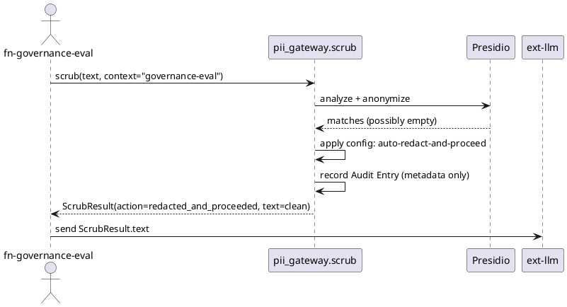
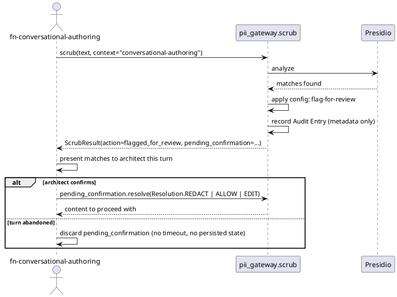

# Contract: `scrub()`

The one call surface every consumer package uses (FR-001). Full field definitions are
in [data-model.md](../data-model.md); this contract shows the call shape and one example
per outcome.

```python
def scrub(text: str, *, context: str) -> ScrubResult: ...
```

- `text`: architect-authored content about to be sent to an LLM provider.
- `context`: caller identity (`"governance-eval"`, `"spec-generator"`,
  `"conversational-authoring"`, or any other registered context); an unrecognized
  context falls back to the global default failure-mode (spec Edge Cases).

## Sequence — automated drafting path (`governance-eval` / `spec-generator`)



## Sequence — conversational-authoring path (flag-for-review)



## Example outcomes

| Input | `context` | `action` | `text` |
|---|---|---|---|
| `"Contact Jane Doe at jane@example.com"` | `governance-eval` | `redacted_and_proceeded` | `"Contact <PERSON> at <EMAIL_ADDRESS>"` |
| `"The event-sourcing pattern decouples writes from reads."` | `spec-generator` | `passed_through_unchanged` | identical to input |
| `"My SSN is 234-56-7890"` | `conversational-authoring` | `flagged_for_review` | input text, with `pending_confirmation` set — no mutation until resolved |
| (detector engine raises) | any | matches `DetectorCategoryConfiguration.failure_mode` for that context | treated as a match, never a silent pass-through |

## Settings router contract

`create_settings_router(contexts: Sequence[str], prefix: str = "/settings/pii-gateway") -> APIRouter`
— same shape as `llm_provider_config.router.create_settings_router` (ADR-0034). Exposes:

- `GET {prefix}/state` — active categories and failure-mode per registered context.
- `PUT {prefix}/contexts/{context_id}` — update that context's active categories /
  failure-mode (FR-009); takes effect on the next `scrub()` call (SC-003).
- `GET {prefix}` — the settings HTML page.

See [quickstart.md](../quickstart.md) for runnable examples.
