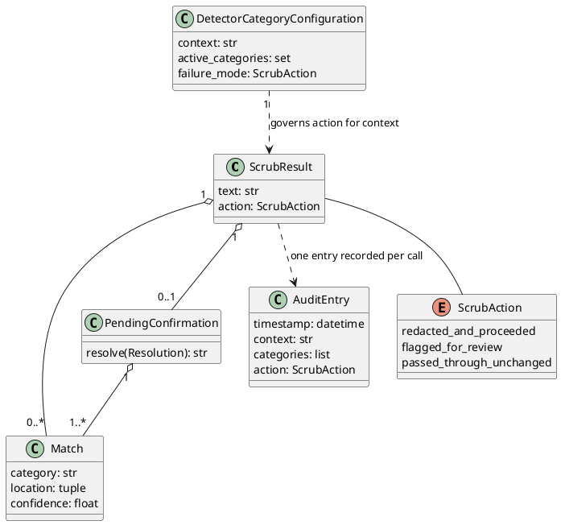
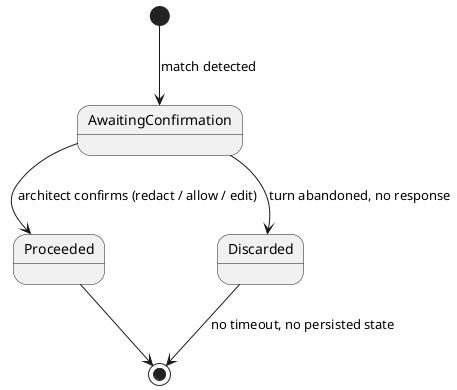

# Data Model: PII Anonymization Gateway

Single home for entity shape, relationships and lifecycle (Principle XI) — `spec.md`'s
Key Entities section links here rather than restating fields. The class diagram below is
the single source for fields and relationships; the notes after it carry only what a UML
diagram can't express (constraints, rationale, persistence rules).

## Class Diagram

## Entity Notes

### `ScrubResult`

`text` is byte-for-byte identical to input when no match occurs (FR-004).
`pending_confirmation` is set only when `action == flagged_for_review`. `ScrubAction`'s
three values are `spec.md`'s "redacted-and-proceeded" / "flagged-for-review" /
"passed-through-unchanged" in snake_case — same outcomes, no fourth state anywhere.

### `Match`

A span matching more than one category produces one `Match` per matching category,
sharing the same `location`; redaction is still applied once per span (spec Edge Cases).
A detector-engine error produces a synthetic `_ENGINE_ERROR` match with `confidence: 0.0`
carrying no text (research.md R6, fail-closed).

### `PendingConfirmation`

Scoped to the current `scrub()` call / conversational turn only — **never persisted or
resumed across calls** (2026-10-31 clarification, User Story 2 Scenario 3). There is no
database row, cache entry, or queue item for this state: it exists only as the return
value of one `scrub()` invocation and the caller's in-memory handling of it within that
turn. `resolve` is not serializable — a closure over the original text, by design
(nothing to persist).

**Lifecycle** (conversational-authoring context only):

Every other context skips this state entirely: a match goes straight from detection to
`redacted_and_proceeded` (or to the fail-closed synthetic match on engine error).

### `Audit Entry`

Metadata-only; **never contains the matched text or surrounding content** (FR-011).
Persisted as one JSON line per call (research.md R3). `categories` holds distinct
`Match.category` values from the call only — no locations, no confidence, no text.

### `Detector Category Configuration`

Keyed by caller `context`; an absent context falls back to the global default (spec Edge
Cases). Changes apply to the next `scrub()` call with no restart (SC-003). Persisted as
TOML (research.md R4); read and written through the mountable settings router
(research.md R5, [contracts/scrub.md](contracts/scrub.md#settings-router-contract)) —
the same `llm-provider-config`-style page/JSON-API pair an operator uses for FR-009.
`failure_mode` defaults to `redacted_and_proceeded` globally or `flagged_for_review` for
`conversational-authoring` (ADR-0014); operator-overridable per FR-009, and neither value
is a hard-block.

No new elements in `architecture/model/` — `sub-pii-gateway`, `art-pkg-pii-gateway`, and
`sw-presidio` already model this package at the architecture-layer granularity
(ADR-0043/ADR-0044); the classes above are implementation-level data shapes, not separate
architecture elements.
