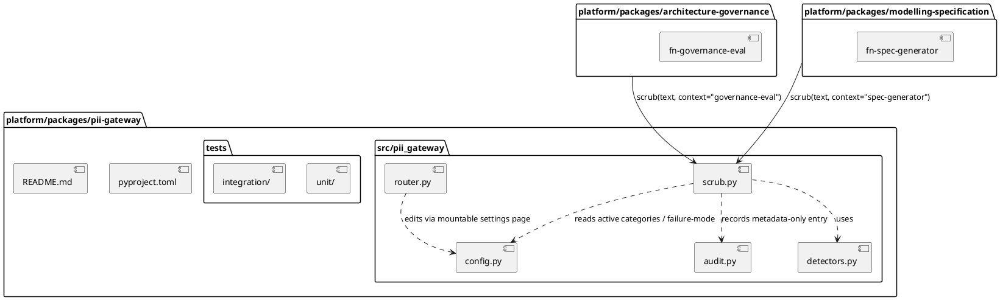

# Implementation Plan: PII Anonymization Gateway

**Branch**: `001-pii-gateway` | **Date**: 2026-10-31 | **Spec**: [spec.md](spec.md)

**Input**: Feature specification from `platform/packages/pii-gateway/specs/001-pii-gateway/spec.md`

## Summary

Build `platform/packages/pii-gateway`, a shared non-subsystem package (ADR-0014,
ADR-0034's general pattern) exposing a `scrub(text, *, context) -> ScrubResult` contract
backed by Presidio (ADR-0043). Every caller gets auto-redact-and-proceed on a detected
match except the `conversational-authoring` context, which gets flag-for-review
(ADR-0014 amendment). `architecture-governance` and `modelling-specification` are wired
through with integration tests proving a planted PII string never reaches a stubbed LLM
call; `fn-ai-markdown-conversion`/`fn-policy-quality-feedback` are confirmed to keep
bypassing the gateway (ADR-0031). A mountable settings router (ADR-0034/ADR-0020 pattern)
lets an operator toggle detector categories and per-context failure-mode actions without a
code change. See [research.md](research.md) for the technical decisions and
[data-model.md](data-model.md) for entity/state detail.

## Technical Context

**Language/Version**: Python 3.12 (project floor `>=3.11,<3.14`, matching every other
`platform/packages/*` package).

**Primary Dependencies**: `presidio-analyzer` + `presidio-anonymizer` (ADR-0043,
detection/anonymization engine — adds `sw-presidio` to `architecture/model/`, already
present per ADR-0044), `pydantic` v2 (config/`ScrubResult` models, matching
`llm-provider-config`'s pattern), `fastapi` (mountable settings router, ADR-0034/ADR-0020
pattern), `tomli-w`/`tomllib` (settings persistence, mirroring
`llm-provider-config/src/llm_provider_config/store.py`'s TOML file approach).

**Storage**: A local, git-ignored TOML config file for detector-category/failure-mode
settings (mirrors `llm-provider-config`'s `~/.config/frictionless-architect/*.toml`
pattern) — no database. The metadata-only audit log (FR-011) is appended to a local
log file; no PII/PHI-bearing storage of any kind is introduced.

**Testing**: `pytest` (unit tests for `scrub()`, detector-category config, audit
logging) plus `tests/api/`-style integration tests proving a planted PII string never
reaches a stubbed `litellm.completion` call from `architecture-governance` and
`modelling-specification`'s drafting paths, consistent with
`scripts/pre_merge_checks.sh`'s existing suite.

**Target Platform**: Linux server / local dev (same as every other `platform/packages/*`
package) — single-user local MVP (ADR-0024).

**Project Type**: Library (shared package consumed as a path dependency, ADR-0002) with
an optional mountable FastAPI router for its settings surface — no standalone service.

**Performance Goals**: `scrub()` returns within 2 seconds for typical-length content (a
single ADR paragraph or chat message), measured across every caller context (SC-005,
2026-10-31 clarification).

**Constraints**: Fail closed on a detector-engine error (treated as a match, never a
silent pass-through — spec Assumptions); no PII/PHI value ever written to the audit log
(FR-011); flag-for-review state is turn-scoped only, never persisted (User Story 2
Scenario 3).

**Scale/Scope**: Three known callers at this feature's scope —
`architecture-governance` (`fn-governance-eval`), `modelling-specification`
(`fn-spec-generator`), and the `conversational-authoring` context declared for GH #68's
future use (not built here). Single-user local MVP volumes (ADR-0024) — no concurrency or
multi-tenant design needed.

## Constitution Check

*GATE: Must pass before Phase 0 research. Re-check after Phase 1 design.*

- **Principle II (Testing Standards)** — satisfied by plan: unit tests for `scrub()`/
  config/audit logging plus integration tests on both wired consumers, aiming at the
  90% coverage gate like every other package.
- **Principle IV (Performance)** — SC-005's 2-second ceiling is the stated budget;
  Presidio's NER recognizers are the dominant cost and are addressed in research.md R1.
- **Principle V (Security)** — this package's entire purpose is a security control; the
  audit log's metadata-only constraint (FR-011) and fail-closed default are designed in
  from the start, not bolted on.
- **Principle VI (State Management)** — the flagged-for-review lifecycle (turn-scoped,
  discarded on abandonment, never persisted) is an explicit state-transition rule,
  documented in data-model.md.
- **Principle X (Decision Traceability)** — detector engine (ADR-0043), scope (ADR-0014),
  failure-mode defaults (ADR-0014 amendment), and the technology-layer elements
  (ADR-0044) are already Accepted ADRs this plan incorporates as constraints, not
  decisions it makes itself. **Model impact: none** — `sub-pii-gateway`,
  `art-pkg-pii-gateway`, `sw-presidio`, and their relationships already exist in
  `architecture/model/` (backfilled under ADR-0043/ADR-0044); this plan surfaces no gap
  requiring new elements.
- **Principle XI (Concise, Non-Duplicative Spec Artefacts)** — `research.md` holds the
  decision table, `data-model.md` the entities/lifecycle, `contracts/` one example
  per interface, `quickstart.md` the validation commands; this `plan.md` only summarizes
  and links.

No violations requiring Complexity Tracking.

## Project Structure

### Documentation (this feature)

```text
platform/packages/pii-gateway/specs/001-pii-gateway/
├── plan.md              # This file (/speckit-plan command output)
├── research.md          # Phase 0 output (/speckit-plan command)
├── data-model.md        # Phase 1 output (/speckit-plan command)
├── quickstart.md        # Phase 1 output (/speckit-plan command)
├── contracts/           # Phase 1 output (/speckit-plan command)
└── tasks.md             # Phase 2 output (/speckit-tasks command - NOT created by /speckit-plan)
```

### Source Code (repository root)



**Structure Decision**: Mirrors `platform/packages/llm-provider-config`'s layout exactly
(own `pyproject.toml`, `src/pii_gateway/`, `tests/{unit,integration}/`, `README.md`,
`specs/001-pii-gateway/`), per ADR-0034's shared-package pattern. `architecture-governance`
and `modelling-specification` take it as a path dependency (ADR-0002) and call `scrub()`
from their existing drafting call sites — no new packages or directories on their side.

## Complexity Tracking

*No violations to justify — table omitted.*
