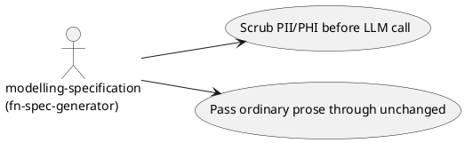
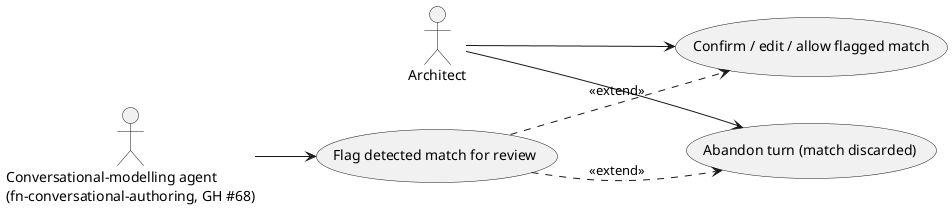
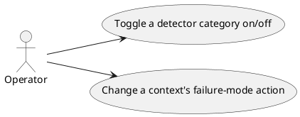

# Feature Specification: PII Anonymization Gateway

**Feature Branch**: `feature/gh-136-pii-gateway`

**Created**: 2026-10-31

**Status**: Draft

**Input**: User description: "Build platform/packages/pii-gateway per GH #136: the shared,
non-subsystem package (ADR-0014, ADR-0034's general pattern) that scrubs PII/PHI from
content before it reaches the LLM provider, for every LLM ingestion path named in scope:
architecture-governance's ADR/evaluation drafting (fn-governance-eval),
modelling-specification's spec drafting (fn-spec-generator), and the
conversational-modelling agent's prompts (fn-conversational-authoring, GH #68, tracked as
that package's own obligation, not built here). Policy/regulatory-standard documents
remain exempt (ADR-0031)."

Decision record: [ADR-0014](../../../../../docs/adr/0014-pii-anonymization-gateway.md)
(mandatory scope and default failure-mode behavior),
[ADR-0043](../../../../../docs/adr/0043-pii-gateway-detector-library-presidio.md)
(detector/anonymization engine choice), [ADR-0034](../../../../../docs/adr/0034-shared-packages-and-llm-provider-config.md)
(shared-package pattern and mountable-router UI precedent),
[ADR-0031](../../../../../docs/adr/0031-fr016-no-redaction-for-policy-documents.md)
(policy-document exemption this package does not touch).

## Clarifications

### Session 2026-10-31

- Q: If a flagged-for-review match in the conversational-authoring context gets no
  confirmation from the architect, what should happen to it? → A: No timeout — the pending
  confirmation is scoped to the current conversational turn; if the architect abandons the
  turn, it is simply discarded, nothing persists.
- Q: Does the `scrub()` call need a maximum response-time target? → A: Yes — a measurable
  ceiling of 2 seconds for typical-length content (a single ADR paragraph or chat
  message), the same bound for every caller context.
- Q: Should every `scrub()` call be logged for audit purposes, and must the log ever
  contain the actual detected PII/PHI value? → A: Metadata-only audit log — records that a
  call happened, which categories matched, and the action taken; never the matched text or
  surrounding content.

## User Scenarios & Testing *(mandatory)*

### User Story 1 - Automated drafting never sends unscrubbed PII/PHI to an LLM (Priority: P1)

`modelling-specification`'s spec drafting sends architect-authored content to an LLM
provider with no human reviewing the outgoing text first. Before the call happens, the
content is scrubbed of PII/PHI and, if nothing is found, passed through unchanged.
`architecture-governance`'s AI-assisted ADR/evaluation drafting is in scope for this same
guarantee (ADR-0014), but that package doesn't exist yet (`ARCHITECTURE.md` §4 lists it
**build**, not built) — there is no drafting call site to wire today. Wiring it is
deferred to that package's own build-out, the same deferral already used for GH #68's
conversational-authoring agent (2026-10-31 decision, GH #136 comment thread).

**Why this priority**: This is ADR-0014's mandatory requirement and the reason GH #136
exists — without it, FR-004 is unenforced in code on this feature's only buildable
consumer today.

**Independent Test**: Call the scrub contract directly with a text sample containing a
planted PII/PHI string; assert the string never appears in what would be sent onward. Call
it again with ordinary technical prose containing no PII/PHI; assert the text is returned
unchanged.

**Acceptance Scenarios**:

1. **Given** text containing a name, email, phone number, or physical address, **When** it
   is scrubbed, **Then** the matched span is redacted and the call proceeds (auto-redact
   default).
2. **Given** text containing a PHI-specific identifier (per ADR-0014's language), **When**
   it is scrubbed, **Then** the matched span is redacted and the call proceeds.
3. **Given** text containing no PII/PHI, **When** it is scrubbed, **Then** the returned
   text is byte-for-byte identical to the input.
4. **Given** `modelling-specification`'s spec-drafting path, **When** it sends content to
   the LLM provider, **Then** a planted PII string in a test fixture never reaches the
   (stubbed) LLM call.

---

### User Story 2 - A detected match asks the architect first when they're already there (Priority: P2)

The conversational-modelling agent (GH #68, not built in this feature) will send an
architect's free-text input to an LLM. Unlike the unattended drafting paths, an architect
is present in that same conversational turn, so a detected match pauses for their
confirmation instead of being silently redacted.

**Why this priority**: Resolves the 2026-10-25 spec-alignment audit's open question and
the 2026-10-31 failure-mode decision (ADR-0014) — this package must expose the
flag-for-review behavior GH #68 will depend on, even though it doesn't call it yet.

**Independent Test**: Call the scrub contract with `context` set to the
conversational-authoring caller identity and a planted PII string; assert the result is a
pending confirmation, not a silently redacted pass-through, and that nothing reaches an
LLM call until that confirmation is given.

**Acceptance Scenarios**:

1. **Given** the conversational-authoring context and a detected match, **When** scrubbed,
   **Then** the result is a flagged-for-review state, not an auto-redacted pass-through.
2. **Given** a confirmation response (redact / allow / edit), **When** supplied, **Then**
   the call proceeds with the confirmed content.
3. **Given** a pending confirmation whose conversational turn is abandoned with no
   response, **When** the turn ends, **Then** the pending item is discarded — no timeout
   timer, no persisted state, nothing to resume later (2026-10-31 clarification).

---

### User Story 3 - An operator changes detector behavior without touching code (Priority: P3)

An operator wants to turn a detector category on or off, or change what happens on a
match for a given caller, without a code change or redeploy.

**Why this priority**: GH #136 requires a config surface; lowest priority because the
hard-coded defaults from ADR-0014 already make the package usable without it.

**Independent Test**: Change a detector category's active state or a context's
failure-mode action through the settings surface, then call the scrub contract again;
assert the new behavior applies immediately.

**Acceptance Scenarios**:

1. **Given** a detector category is turned off, **When** matching text is scrubbed,
   **Then** that category's matches are no longer flagged.
2. **Given** a caller context's failure-mode action is changed, **When** a match occurs
   for that context, **Then** the newly configured action is taken.

---

### Edge Cases

- What happens when the input contains no PII/PHI? → Returned unchanged (User Story 1,
  Scenario 3).
- What happens when a span matches more than one category (e.g. a string that looks like
  both a name and an address fragment)? → Recorded as separate matches against each
  matching category; redaction still applies once to the span.
- What happens when the detector engine itself errors (not a clean "no match")? → Treated
  the same as a detected match for that caller's context (fails closed), never as a silent
  pass-through of unscrubbed content.
- What happens when a caller doesn't pass a recognized `context`? → Falls back to the
  global default failure-mode (auto-redact); only the conversational-authoring context
  gets the differentiated flag-for-review behavior.
- What happens when a flagged-for-review item gets no confirmation (the architect
  abandons the turn)? → Discarded with the turn; no timeout, no persisted state
  (2026-10-31 clarification).

## Requirements *(mandatory)*

### Functional Requirements

- **FR-001**: The package MUST expose a `scrub(text, *, context)` call contract any
  consumer package can call before sending content to an LLM provider.
- **FR-002**: The package MUST detect and redact common PII categories — name, email,
  phone number, physical address — in input text.
- **FR-003**: The package MUST detect and redact PHI categories per ADR-0014's language.
- **FR-004**: The package MUST return text containing no PII/PHI unchanged.
- **FR-005**: The package MUST apply auto-redact-and-proceed as the default action on a
  detected match for every caller context, except the conversational-authoring context,
  which MUST default to flag-for-review (ADR-0014).
- **FR-006**: `architecture-governance`'s ADR/evaluation drafting path MUST call this
  package's scrub contract before any content reaches the LLM provider, once that
  package is built — tracked as `architecture-governance`'s own acceptance obligation
  (2026-10-31 decision), not a task of this feature, since the package doesn't exist yet.
- **FR-007**: `modelling-specification`'s spec-drafting path MUST call this package's
  scrub contract before any content reaches the LLM provider.
- **FR-008**: Policy/regulatory-standard document conversion
  (`fn-ai-markdown-conversion`, `fn-policy-quality-feedback`) MUST continue to call the
  LLM provider directly, bypassing this package (ADR-0031's exemption), verified by an
  explicit test or code comment rather than left implicit.
- **FR-009**: The package MUST provide a configuration surface letting an operator change
  which detector categories are active and which failure-mode action applies per caller
  context, without a code change.
- **FR-010**: The package's README MUST document the scrub contract, the configuration
  surface, and which callers are required to use it.
- **FR-011**: The package MUST record a metadata-only audit entry for every `scrub()`
  call — that a call happened, which categories matched, and the action taken — and MUST
  NOT include the matched text or surrounding content in that entry
  (2026-10-31 clarification).

### Key Entities

Field-level shape, relationships and lifecycle live in `data-model.md`'s class diagram
(Principle XI) — summarized here only in business terms:

- **ScrubResult**: what one `scrub()` call hands back to its caller — the content to
  proceed with and what was done to get there.
- **Audit Entry**: the metadata-only record that a `scrub()` call happened, kept separate
  from `ScrubResult` so no PII/PHI value is ever written to the audit trail.
- **Detector Category Configuration**: the operator-editable setting (FR-009) that
  decides which categories are checked and what happens on a match, per caller.

## Success Criteria *(mandatory)*

### Measurable Outcomes

- **SC-001**: Zero planted PII/PHI test strings reach a stubbed LLM call across
  `modelling-specification`'s wired-through integration test (this feature's only
  buildable consumer today — see User Story 1, `architecture-governance` deferral).
- **SC-002**: A representative sample of ordinary technical prose (this platform's typical
  content) passes through unaltered — zero false-positive redactions across the sample
  set used in unit tests.
- **SC-003**: An operator can change a detector category's active state or a context's
  failure-mode action, and see it take effect on the next call, without a code change or
  redeploy.
- **SC-004**: Every detected match in the conversational-authoring context results in a
  pending confirmation state, never a silent redaction — 100% across the flagged-context
  test cases.
- **SC-005**: A `scrub()` call on typical-length content (a single ADR paragraph or chat
  message) returns within 2 seconds, measured across every caller context
  (2026-10-31 clarification).

## Assumptions

- Detector/anonymization engine (Presidio) and the default failure-mode split
  (auto-redact globally, flag-for-review for conversational-authoring) are already
  decided — ADR-0043 and ADR-0014 — and are constraints on this spec, not open questions.
- A detector-engine internal error is treated the same as a detected match (fails closed)
  rather than silently passing unscrubbed content through; this is a new default this spec
  introduces, not yet covered by an ADR, and should be revisited if it proves too strict
  in practice.
- GH #68's conversational-modelling agent is not built here; this package only commits to
  the `scrub()` contract and flag-for-review behavior that agent will depend on once built
  (tracked as its own acceptance obligation, per the 2026-10-31 GH #68 comment).
- `architecture-governance` is not built here either (`ARCHITECTURE.md` §4: status
  **build**, not yet built) — the same deferral pattern applies: this package exposes
  the `scrub()` contract FR-006 requires, and wiring it in is that package's own
  acceptance obligation once it exists, not a task of this feature.
- Single-user local MVP scope (ADR-0024) applies — no multi-tenant configuration or
  credential concerns beyond what `llm-provider-config` already established.
