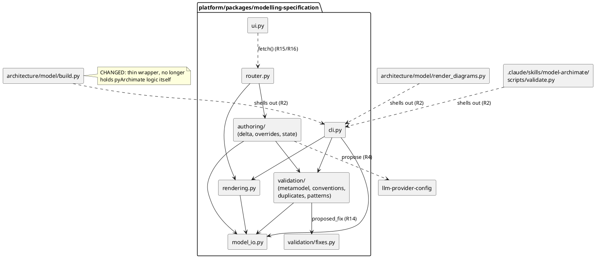

# Implementation Plan: Conversational ArchiMate Model Authoring

**Branch**: `feature/gh-108-conversational-architecture-agent` (issue #108) | **Date**: 2026-10-08 | **Spec**: [spec.md](spec.md)

**Input**: Feature specification from `specs/004-conversational-model-authoring/spec.md`

## Summary

A new `platform/packages/modelling-specification` package (subsystem 6, ADR-0011; already
named `art-pkg-modelling-specification` in the model) hosts the conversational agent: an LLM
call (via `llm-provider-config`/`litellm`, ADR-0034) turns an architect's natural-language
request into a structured candidate delta, which a shared validation module — metamodel
checks via pyArchimate plus configurable Enterprise Convention Rules — accepts or rejects
before anything touches `architecture/model/`. The same package also absorbs
`architecture/model/build.py`'s load/merge/validate logic and `render_diagrams.py`'s
view-render logic; root's `build.py`, `render_diagrams.py` and the skill's `validate.py`
become thin wrappers shelling into it, so CI and the vendored/generated YAML layers (ADR-0029,
ADR-0035) keep one deterministic, non-conversational pipeline rather than a second
implementation (R2). A FastAPI router, mounted per ADR-0020, serves the chat turn and a render
endpoint the split-screen UI polls after apply or on request (FR-011–FR-013). Entities, ids
and lifecycles are in [data-model.md](data-model.md); decisions in [research.md](research.md).
The business-layer wiring Assumption 6 defers to this plan is in "Model impact" below, filed
as ADR-0037 before `/speckit-tasks`.

**UI Phase (added 2026-10-11, after the API landed in commit `ddb2094`)**: the backend above
is complete and merged; this phase adds the split-screen UI itself — a compact chat pane on
top and a render pane below spanning the full width (horizontal split, R19, maximises the
rendering surface), as one more route (`ui.py`, R15) in the same package, following
`controls-compliance-catalog`'s playground as the one existing per-subsystem-UI precedent
(ADR-0020). No new entities, no new persistent surface, no model impact (R16) — it is a thin
fetch() client over the API phase's own contract. Decisions R15–R19; no new data-model
entities; `contracts/api.md`'s new `GET /authoring/` route and `quickstart.md` step 10 cover it.

## Technical Context

**Language/Version**: Python 3.12 (floor `>=3.11,<3.14`), matching `platform/pyproject.toml`

**Primary Dependencies**: FastAPI + uvicorn (existing stack); `pyarchimate` promoted from a
root dev-only dependency to a runtime dependency of the new package; `rapidfuzz` (already a
root **test**-only dependency, promoted to runtime here) for FR-005 duplicate matching;
`llm-provider-config` + `litellm` (ADR-0034, same pattern as `controls-compliance-catalog`)
for the natural language-to-delta call; `pyyaml` for Enterprise Convention Rule config and model-delta
read/write, matching `architecture/model/build.py`'s own YAML authoring

**Storage**: `architecture/model/*.yaml` for applied changes (regenerated via `build.py`'s
logic, now ported into the package per R2, never hand-edited); new
`architecture/model/conventions.yaml` for Enterprise
Convention Rules (new persistent surface, Assumption 2); Override Decision Records are
auto-drafted ADR stubs under `docs/adr/` (R7), not a `store-ledger` entry or new store. Candidate
Deltas are **in-process memory only**, keyed by conversation/session id — no database, per the
session-scoped Clarification and the single-user-local MVP (ADR-0024)

**Testing**: `pytest` + `pytest-mock` for the validation module and LLM-call seam (fake
`litellm.completion`, mirroring `llm-provider-config`'s own test pattern — no live network);
`httpx` contract tests against the mounted FastAPI router (existing `tests/api/` pattern);
`behave` scenarios for the three User Stories' acceptance scenarios (`acceptance-author`)

**Target Platform**: Same host as the existing visualiser — Linux server / devcontainer,
FastAPI + uvicorn; the split-screen UI (R15) is a mounted fragment served by the same
process, not a new app or a separate frontend build

**UI Phase dependencies**: none new — `fastapi.responses.HTMLResponse` (already a FastAPI
dependency) for the page; `playwright` for its behave scenario is already a shared
`platform/pyproject.toml` dev dependency (same one `controls-compliance-catalog`'s own UI
behave scenarios use), not added per-package

**Project Type**: Web service — new `platform/packages/modelling-specification` package
(ADR-0002 monorepo path-dependency pattern, mirroring `controls-compliance-catalog`), **not**
`src/frictionless_architect`: the model already names this package (`art-pkg-modelling-specification`,
status "build") as subsystem 6's home, and `src/` is the pre-migration flat layout
(`ARCHITECTURE.md` §8) new subsystem code does not join

**Performance Goals**: No explicit NFR in the spec; SC-001–SC-005 are correctness criteria,
not latency ones. Principle IV's 200ms rule does not bind an LLM round-trip — deferred to
`NONFUNCTIONALS.md` only if it later proves load-bearing

**Constraints**: Validate before apply, every time (FR-002/003) — a candidate delta is
checked against an in-memory merge of the current model, never written to `architecture/model/`
until accepted; never silently apply, autocorrect or drop (FR-004/007); session-scoped state
only, nothing resumes after an interruption (Clarification 2); single architect at a time
(Assumption 5, ADR-0024)

**Scale/Scope**: One architect, one conversation at a time; current model is 425 elements /
872 relationships / 45 views (`build.py` output, 2026-10-11) — validation runs against that
scale, not a multi-tenant one

## Constitution Check

*GATE: passed before Phase 0; re-checked after Phase 1 — still passes.*

| Principle | Assessment |
|---|---|
| I. Code Quality | Validation, duplicate-check, pattern-check and LLM-call are separate pure-ish functions over the in-memory model merge; no single function spans more than one concern. Pass. |
| II. Testing | TDD order in tasks: validation-module unit tests (fixture deltas) before the FastAPI contract tests before behave. New package carries its own 90% gate via `scripts/platform_checks.sh`. Pass. |
| III. UX Consistency | Rejections carry the specific rule and a proposed fix (FR-004); duplicate/pattern flags use the same keep/merge/reject decision shape in both cases. UI Phase: the chat pane surfaces the same `validation_result`/`duplicates`/`pattern_suggestions` shapes verbatim rather than inventing a parallel presentation; the Apply control's state `<select>` (R17, defaulting to a visible Target) is the UI's one addition, and it keeps the state an explicit, visible choice the API's own 422 contract already models. Pass. |
| IV. Performance | N/A — no hot path; LLM latency is inherent to the feature, not a regression to guard. Pass. |
| V. Security | No new secret handling: the LLM call reuses `llm-provider-config`'s keyring-backed credential resolution (ADR-0034) rather than a new path. NL input is never interpolated into a shell call or raw SQL/Cypher; it only ever becomes structured delta fields validated against the metamodel. Pass. |
| VI. State Mgmt | Candidate Delta lifecycle (proposed → validated/rejected → accepted/overridden/discarded) is a documented state machine in `data-model.md`. Pass. |
| VII. Integrity | Every candidate is validated against the same pyArchimate checks `build.py`/`validate.py` already enforce, before, not after, it reaches `architecture/model/`. Pass. |
| VIII. Durability | Applied changes land in the existing YAML schema (ADR-0007/0008) via the existing regeneration path; no new on-disk format for the model itself. Pass. |
| IX. Cross-Platform | FastAPI/Python, no OS-specific paths beyond what the existing visualiser already assumes. UI Phase: inline SVG + vanilla JS, no browser-specific API; verified in the same Playwright/Chromium harness `controls-compliance-catalog`'s UI scenarios already run under. Pass. |
| X. Decision Traceability | Model impact stated below; **ADR-0037 filed** for: package location, validation-module incorporation (shared between the skill and the app without forking, Assumption 1), Enterprise Convention Rule config surface, the Override Decision Record auto-drafted-ADR mechanism (R7), and the business-layer/ValueStream wiring (Assumption 6). |
| XI. Concise Artefacts | Entity detail lives only in `data-model.md`; this plan links to it rather than restating fields. |

No violations; Complexity Tracking is empty — a new platform package is the sanctioned
structure (ADR-0002/0011), not a deviation needing justification.

### Model impact

New elements (`architecture/model/elements.yaml`):

| Type | Id | Name |
|---|---|---|
| ValueStream | `vs-intent-to-model` | Intent to Model |
| Outcome | `outcome-intent-becomes-model-truth` | Architectural Intent Becomes Governed Model Truth |
| BusinessProcess | `process-conversational-authoring` | Conversational Model Authoring |
| DataObject | `do-convention-rules` | Enterprise Convention Rules |
| Requirement | `req-conversational-authoring-alignment` | Strategically Aligned, Convention-Compliant Conversational Authoring |
| Driver | `driver-authoring-friction` | Architect Authoring Friction & Governance Consistency |
| Assessment | `assess-manual-authoring-risk` | Hand-edited model changes are too slow and too easily ungoverned to trust |
| BusinessFunction | `bfn-conversational-authoring` | Conversational Model Authoring |

New relationships (`architecture/model/relationships.yaml`):

- `Serving coa-executable-governance → vs-intent-to-model` and `Association stk-architecture → vs-intent-to-model` (same pattern as the other four outcome streams)
- `Realization vs-intent-to-model → outcome-intent-becomes-model-truth`
- `Realization outcome-intent-becomes-model-truth → goal-frictionless-architecture` (same pattern as the other four outcomes)
- No direct `Serving cap-conversational-governance → vs-intent-to-model`: it is derived via `Realization cap-conversational-governance → coa-executable-governance` and `Serving coa-executable-governance → vs-intent-to-model`.
- `Realization process-conversational-authoring → cap-conversational-governance`
- `Realization fn-conversational-authoring → process-conversational-authoring` (the settled app function now realizes a business process, resolving Assumption 6)
- `Assignment role-ea → bfn-conversational-authoring` and `Assignment role-sa → bfn-conversational-authoring` (both roles jointly own the business function, not a Serving edge from the process — corrected here; the model has always wired it this way, this table just hadn't caught up); `Composition bfn-conversational-authoring → process-conversational-authoring` ("comprises")
- `Triggering process-blueprint-traceability → process-conversational-authoring` ("blueprints proposed as model changes") and `Triggering process-conversational-authoring → process-solution-design` ("validated changes composed into") — wires conversational authoring into the existing blueprint/solution-design process chain
- `Aggregation store-frameworks → do-convention-rules` (same pattern as `do-metamodel`)
- `Realization cap-conversational-governance → req-conversational-authoring-alignment` (same pattern as the other eight capabilities, each realizing at least one requirement)
- `Realization req-conversational-authoring-alignment → outcome-intent-becomes-model-truth` (same pattern as the other requirements, each realizing exactly one outcome)
- `Access fn-conversational-authoring → do-convention-rules` (Read)
- `Association stk-architecture → driver-authoring-friction`, `Influence driver-authoring-friction → assess-manual-authoring-risk`, `Influence assess-manual-authoring-risk → outcome-intent-becomes-model-truth` (same Stakeholder→Driver→Assessment→Outcome pattern as the other four outcomes)
- `Influence principle-policy-as-code → req-conversational-authoring-alignment` (same principle already influences `req-control-catalog`; `do-convention-rules` is version-controlled, machine-executable policy, not prose, same as the regulatory mappings it already governs)
- `Triggering vs-intent-to-model → vss-baseline` (labelled "validated change extends the baseline" — an applied conversational change is what `vss-baseline`'s "blueprints and solution designs" are curated from; same cross-stream hand-off pattern as `vss-reconcile → vss-specify`, so `vs-intent-to-model` stays single-stage (ADR-0037) but is no longer disconnected from the pipeline)

Override Decision Records are **not** a model element: per R7 they're auto-drafted ADR stubs
under `docs/adr/`, so no new DataObject, aggregation or access relationship exists for them.

No existing element, relationship or view is retired or renamed. `tasks.md` carries the YAML
edits, `build.py` regeneration and `validate.py`/shared-module re-check (Principle X).

**UI Phase model impact: none.** The chat/render pages add no element, relationship or view —
R16 is explicit that they hold no state the API doesn't already own.

## Project Structure

### Documentation (this feature)

```text
specs/004-conversational-model-authoring/
├── plan.md, research.md, data-model.md, quickstart.md
├── contracts/api.md
├── checklists/requirements.md
└── tasks.md             # Phase 2 — /speckit-tasks (not created here)
```

### Source Code (repository root)

New package `platform/packages/modelling-specification` (`art-pkg-modelling-specification`),
built like `controls-compliance-catalog`: own `pyproject.toml` (fastapi, pyarchimate,
rapidfuzz, `llm-provider-config` path dep, litellm, pyyaml), `src/`, `tests/unit/`, `specs/`.
Internal module layout and the three root wrappers it replaces:



Also changed: `architecture/model/conventions.yaml` (NEW, Enterprise Convention Rules);
`elements.yaml`/`relationships.yaml` (see "Model impact"); affected diagrams (regenerated);
root `pyproject.toml` (drops the now-unused `rapidfuzz` **test**-only dependency only —
`pyarchimate` stays: `.claude/skills/diagram-archimate/scripts/model_to_puml.py`,
`diagram-c4/scripts/model_to_c4.py` and `model-archimate/scripts/{viewpoints,check_derived}.py`
still import it directly under the root venv, independent of the three scripts R2 ported;
tasks.md T054 corrected in place rather than superseded by a new task); `docs/adr/0037-*.md`
(filed) and `docs/adr/README.md` (index row, added). **UI Phase** adds `ui.py` (the page,
mounted in `app.py` alongside `router` the same way `controls_compliance_catalog.app` mounts
`playground.api.router`), a Playwright-driven `tests/features/conversational_authoring_ui.feature`,
and one contract test (`tests/api/test_ui.py`) asserting the route returns `200 text/html` —
no new dependency (Technical Context, above).

**Structure Decision**: New platform package, not `src/frictionless_architect` — the model
already designates `art-pkg-modelling-specification` as subsystem 6's home and ADR-0002's
monorepo pattern (own `pyproject.toml`/`src/`/`tests/`/`specs/`, path dependency on
`llm-provider-config`) is the established way to add it, mirroring
`controls-compliance-catalog`. The skill script and root's `build.py`/`render_diagrams.py` all
become thin callers into the platform venv rather than each holding a separate implementation
(R2) — CI and the vendored/generated YAML layers (ADR-0029, ADR-0035) still run the same
deterministic pipeline, now with one home instead of three.

## Complexity Tracking

No constitution violations to justify.
