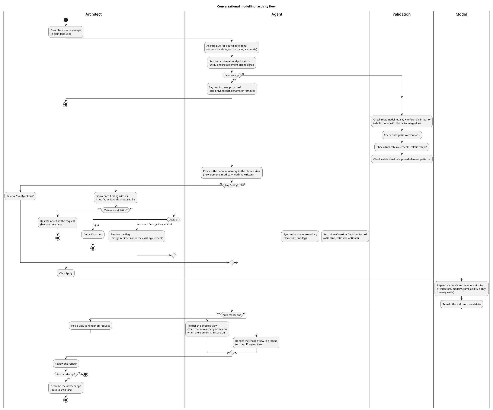
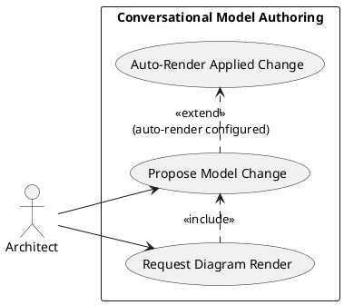
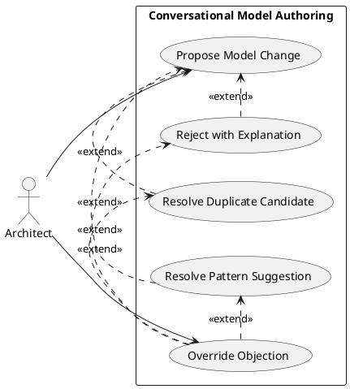
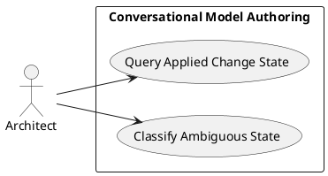

# Feature Specification: Conversational ArchiMate Model Authoring

**Feature Branch**: `feature/gh-108-conversational-architecture-agent`

**Created**: 2026-10-08

**Status**: Draft

**Input**: User description: "Add a conversational AI agent for iteratively authoring the ArchiMate architecture model. An architect describes an intent in natural language; the agent proposes a candidate model delta, validates it against the model-archimate skill's metamodel checks plus configurable enterprise/domain conventions, and on pass renders the affected element(s)/view live in a split-screen UI. On failure it explains the violation and proposes a fix. Duplicate candidates are flagged for an explicit keep/merge/reject decision. Every applied change is classified Current/Transition/Target. Multi-user collaboration and RBAC are out of scope (tracked as GH #83)." (GH #108)

## Clarifications

### Session 2026-10-08

- Q: When checking a proposed element against existing ones, how strict should the "likely duplicate" match be before it's flagged? → A: Fuzzy match across name, type, and description together — any two of the three being similar triggers a flag.
- Q: If the architect closes or interrupts the conversation while a candidate delta is still pending, does it survive to the next session? → A: Session-scoped only — an interrupted session's pending delta is discarded; the architect re-describes it next time.
- Q: If a proposed element resembles an existing one that sits in a different Current/Transition/Target state, should the agent still flag it as a likely duplicate? → A: State is irrelevant to duplication; flag as a duplicate regardless of state, then let the keep/merge/reject decision account for state.
- Q: If a second proposal in the same conversation touches an element already modified earlier but not yet applied, does it build on the pending delta or validate fresh against the last-applied state? → A: Build on the pending delta — the new proposal amends/extends the still-unapplied candidate; one delta accumulates until explicitly applied or discarded.
- Q: When an architect overrides an objection without giving a rationale, must the agent require one before recording the override? → A: Rationale is optional — the agent records the override immediately even with no stated reason, leaving the rationale field blank.
- Q: When a view request resolves to more than one plausible existing view, or to none, should the agent ask the architect to disambiguate or make a best-guess choice? → A: Ask the architect to disambiguate (pick from matches, or restate if none match) rather than guessing.
- Q: When a proposed direct relationship is legal but no established intermediary-element pattern exists yet for that relationship shape, is it applied as-is or does the absence of a pattern itself require a decision? → A: Apply the direct form as-is — absence of a pattern is not itself a reason to require a decision.

### Session 2026-10-09

- Q: Does validating a candidate delta against the ArchiMate metamodel (FR-002) mean checking the whole model with the delta applied, or only the delta's own internal consistency in isolation? → A: Validate the whole resulting model (delta applied) — a break anywhere is caught, so a change valid on its own but breaking referential integrity elsewhere cannot slip through.
- Q: When an architect rejects the agent's proposed fix for an already-rejected change, what should the agent do next? → A: Ask the architect to restate or refine the request — the agent does not auto-retry a different fix, and does not drop the request.

### Session 2026-10-11

- Q: When an architect overrides the agent's objection to proceed anyway, can that override ever bypass a rejection caused by a genuine ArchiMate metamodel-legality violation, as opposed to a duplicate, pattern, or enterprise-convention objection? → A: No — only convention/duplicate/pattern objections are overridable; a genuine metamodel-legality violation can never be overridden.
- Q: FR-005 names "a new element or relationship" as needing a duplicate check, but its match rule only compares against existing elements — does a proposed relationship need its own duplicate check against existing relationships, or was "or relationship" imprecise wording? → A: Relationships need their own check too — a proposed relationship sharing the same source, target, and type as an existing relationship is flagged as a likely duplicate, in addition to the existing element-level check.
- Q: When an architect decides "merge" on a flagged duplicate, does the agent update the existing element's fields with information from the proposed duplicate, or leave the existing element untouched and only redirect the new candidate's relationships onto it? → A: Leave the existing element untouched; redirect the new candidate's relationships onto it and discard the new element itself.
- Q: When an architect picks "accept-pattern" on a flagged Pattern Suggestion, does the agent apply the intermediary-element form for them, or discard the candidate and require the architect to re-describe it? → A: The agent auto-synthesizes a reasonable intermediary element and applies the intermediary-element form directly.
- Q: When the architect's natural-language request is too vague or underspecified to form a well-defined candidate delta, should the agent ask a clarifying question before proposing anything, or make its best guess and let validation/duplicate-checking catch problems afterward? → A: The agent asks a clarifying question before proposing a delta when the request is too vague to produce one with confidence — consistent with the "ask, don't guess" pattern already established for view requests and rejected fixes.

### Session 2026-10-12

- Q: Should the Current/Transition/Target classification stay a required step of applying a change? → A: No. To keep this feature simple the state is optional and superseded for now: the architect models and sees the change in memory as it happens, and Apply is the only write. Tracking *which plateau/option* a change belongs to is deferred to the solution-option work (GH #68 comment), where a Plateau id replaces the fixed three values.

## User Scenarios & Testing *(mandatory)*

### Overall flow

The activities of one conversational modelling session, which the three user stories below break down. Nothing is written to `architecture/model/` before Apply.

### User Story 1 - Propose and see a validated change (Priority: P1)

An enterprise or solution architect describes a model change in plain language (e.g. "add a new application function for X under subsystem Y, served to the EA role"). The agent proposes the model delta, validates it against the ArchiMate metamodel and the configured enterprise conventions, and — once it passes — renders the affected element(s) in a live diagram next to the conversation, without the architect hand-editing any model file or manually re-running a render step.

**Why this priority**: This is the feature's core loop; without it there is no conversational authoring capability at all.

**Independent Test**: Describe a single well-formed change in conversation and confirm a diagram reflecting it appears without any manual file edit or render command.

**Acceptance Scenarios**:

1. **Given** an architect describes a valid, unambiguous model change, **When** the agent proposes the delta, **Then** it validates cleanly against the metamodel and configured conventions and is applied.
2. **Given** a change has just been applied and rendering is configured to happen automatically, **When** the change is applied, **Then** the corresponding diagram renders immediately without the architect asking.
3. **Given** a change has just been applied and rendering is configured to happen on request, **When** the architect asks to see the affected element or a described view, **Then** the corresponding diagram renders immediately, reflecting the current state of the conversation.

---

### User Story 2 - Reject invalid, duplicate, or non-idiomatic proposals with an explanation (Priority: P1)

Invalid, duplicate, and non-idiomatic proposals are never applied, auto-corrected, or dropped silently — each requires an explicit architect decision, and an overridden objection is recorded for later review. Mechanics are in the Acceptance Scenarios and Functional Requirements below.

**Why this priority**: Without this, the agent cannot be trusted to touch the canonical model — the same concern that makes conversational authoring risky in the first place.

**Independent Test**: Describe a change that breaks a metamodel rule, one that duplicates an existing element, and one that proposes a direct relationship where the model's convention is to interpose intermediary elements; confirm all three produce an explanation and none is applied without an explicit decision.

**Acceptance Scenarios**:

1. **Given** a proposed change violates a metamodel rule or a configured convention, **When** the agent validates it, **Then** it rejects the change with a specific, actionable explanation and proposes a fix instead of applying, autocorrecting, or dropping it silently.
2. **Given** a proposed element or relationship resembles an existing one by name, type, or description, **When** the agent checks for duplicates, **Then** it surfaces the candidate(s) and waits for an explicit keep-both, merge, or reject decision before applying anything.
3. **Given** a proposed direct relationship is legal per the metamodel but the model's established pattern normally interposes intermediary element(s) for that relationship shape, **When** the agent checks it, **Then** it flags the shortcut, explains the established pattern, and proposes the intermediary-element form as an alternative, requiring an explicit decision before applying the direct form.
4. **Given** the agent has rejected a change, flagged a duplicate, or suggested a pattern alternative, **When** the architect explicitly overrides that objection and proceeds anyway, **Then** the agent applies the change and records the override — what was overridden, the agent's objection, and the architect's rationale — as a traceable decision for later review.

---

### User Story 3 - Track and query Current/Transition/Target state (Priority: P2) — optional since 2026-10-12

A change MAY be classified Current, Transition, or Target when it is applied, and that classification is queryable afterward; since 2026-10-12 it is not required (see Clarifications) and the UI no longer asks for it. Mechanics are in the Acceptance Scenarios and Functional Requirements below.

**Why this priority**: Valuable and explicitly required by the issue, but the conversational loop (P1) delivers value even before state querying is wired up end to end.

**Independent Test**: Apply a change while specifying its state, then ask the agent what state that change belongs to, independent of any other feature in this spec.

**Acceptance Scenarios**:

1. **Given** an applied change, **When** the architect asks what state it belongs to, **Then** the agent answers Current, Transition, or Target consistent with what was recorded when the change was applied.
2. **Given** a change that is ambiguous about state, **When** the agent processes it, **Then** it asks the architect to classify it rather than guessing.

---

### Edge Cases

- A proposed change touching an element or relationship already modified earlier in the same conversation but not yet applied amends/extends the still-pending candidate delta, rather than being validated as an independent proposal against the last-applied model state.
- A described view request that resolves to more than one plausible existing view, or to none at all, is never guessed: the agent asks the architect to disambiguate among the matches, or to restate the request when nothing matches.
- A duplicate candidate in a different Current/Transition/Target state than the proposed change is still flagged as a duplicate (state is not a differentiator in the match); the architect's keep/merge/reject decision is where a legitimate Plateau variant gets kept.
- A proposed direct relationship that is legal per the metamodel, but for which no established intermediary-element pattern exists yet, is applied as-is — the absence of a pattern is not itself grounds to require a decision.
- A change request that is valid on its own but would break an existing element's referential integrity elsewhere in the model cannot reach "applied": FR-002 validates the whole resulting model with the delta applied, not just the delta in isolation, so the break is caught and the change is rejected like any other metamodel violation.
- When the architect rejects the agent's proposed fix for an already-rejected change, the agent does not auto-retry a different fix and does not drop the request: it asks the architect to restate or refine what they want.
- An architect who overrides an objection without giving a rationale still has the override recorded immediately — the rationale field is left blank, not required before recording.
- An architect who tries to override a rejection caused by an ArchiMate metamodel-legality violation (rather than a convention, duplicate, or pattern objection) cannot proceed via the override mechanism: the agent treats it the same as any other already-rejected change, asking the architect to restate or refine the request (FR-017) instead.
- A pending (proposed but not yet decided) candidate delta is session-scoped: if the conversation is closed or interrupted before the architect accepts, rejects, or revises it, the delta is discarded rather than resumed — the architect re-describes it next time.
- A natural-language request too vague or underspecified to form a well-defined candidate delta (e.g. missing the element type, name, or placement) is never turned into a speculative guess: the agent asks the architect a clarifying question before proposing anything, the same "ask, don't guess" posture used for ambiguous view requests and rejected fixes.

## Requirements *(mandatory)*

### Functional Requirements

- **FR-001**: The agent MUST accept a natural-language description of an intended model change and propose a candidate model delta from it. When the description is too vague or underspecified to form a well-defined delta with confidence (e.g. missing the element type, name, or placement needed to propose anything concrete), the agent MUST ask the architect a clarifying question instead of guessing or proposing a speculative delta.
- **FR-002**: The agent MUST validate every candidate delta against the ArchiMate metamodel (relationship-matrix legality and referential integrity) before it is applied, checking the whole model with the delta applied — not just the delta in isolation — so a change that is valid on its own but breaks referential integrity elsewhere in the model is also caught.
- **FR-003**: The agent MUST validate every candidate delta against a configurable set of enterprise/domain conventions, separate from and in addition to the fixed ArchiMate metamodel rules.
- **FR-004**: When a candidate delta fails metamodel or convention validation, the agent MUST reject it with a specific, actionable explanation of which rule it violated, and propose a corrected alternative rather than applying, auto-correcting, or dropping it silently.
- **FR-005**: Before applying a new element, the agent MUST check it against existing elements for likely duplicates, flagging a candidate when at least two of name, type, and description are similar to an existing element, regardless of whether the existing element's Current/Transition/Target state matches the proposed change's state. Before applying a new relationship, the agent MUST separately check it against existing relationships, flagging a candidate when an existing relationship shares the same source, target, and type as the proposed one, regardless of state.
- **FR-006**: When a likely duplicate is found, the agent MUST present the candidate duplicate(s) to the architect and require an explicit keep-both, merge, or reject decision before applying anything. On a merge decision, the agent MUST leave the existing element or relationship's own fields untouched and instead redirect the new candidate's relationships onto it, discarding the new candidate itself — never editing the existing one's content as part of the merge.
- **FR-007**: The agent MUST NOT silently deduplicate or silently create a duplicate under any circumstance.
- **FR-008**: Before applying a direct relationship, the agent MUST check whether the model's established authoring conventions normally interpose intermediary element(s) for that relationship shape, and if so, flag it and propose the intermediary-element alternative, requiring an explicit decision before applying the direct form. When no such established pattern exists yet for that relationship shape, the direct form is applied as-is without requiring a decision — the absence of a pattern is not itself grounds to flag. On an accept-pattern decision, the agent MUST synthesize the required intermediary element(s) implied by the matched convention rule and apply the intermediary-element form directly, rather than discarding the candidate and asking the architect to re-describe it.
- **FR-009**: A change the agent applies MAY be classified as Current, Transition, or Target state; the classification is optional (2026-10-12) and the architect is never required to give one.
- **FR-010**: When a classification was given, it MUST remain queryable after the fact.
- **FR-011**: Whether a diagram renders automatically after every applied change, or only on an explicit view/object request, MUST be a configurable choice, not a hardcoded behavior.
- **FR-012**: When configured for automatic rendering, the agent MUST render the affected element(s) as a live diagram immediately after a change is applied, without a manual render step.
- **FR-012a**: As the architect proposes a change, the agent MUST render it in memory in the chosen view (new elements marked) without writing anything to `architecture/model/`; Apply is the only write (2026-10-12). After Apply, the displayed view is refreshed from the written model.
- **FR-013**: The agent MUST render a diagram for an explicitly requested object or described view without a manual render step, reflecting the model's state at the time of the request, regardless of the automatic-rendering configuration.
- **FR-014**: When an architect overrides the agent's rejection of a convention violation, a duplicate flag, or a pattern suggestion, and proceeds anyway, the agent MUST record the override as a traceable decision — what was overridden, the agent's original objection, and the architect's rationale if one was given — for later review, rather than discarding it once applied. The architect's rationale is optional; the agent MUST NOT block or re-prompt for one before recording the override. A rejection caused by an ArchiMate metamodel-legality violation (FR-002) is never overridable through this mechanism — the agent continues to ask the architect to restate or refine the request (FR-017) rather than applying a change that would leave the model in an illegal state.
- **FR-015**: When a later request in the same conversation touches an element or relationship already part of the pending candidate delta, the agent MUST amend/extend that pending delta rather than validating the new request as an independent delta against the last-applied model state.
- **FR-016**: When a view request resolves to more than one plausible existing view, or to none, the agent MUST ask the architect to disambiguate among the matches, or to restate the request, rather than guessing or rendering an unconfirmed choice.
- **FR-017**: When the architect rejects the agent's proposed fix for an already-rejected change, the agent MUST ask the architect to restate or refine the request rather than automatically retrying a different fix or dropping the request unprompted.

### Key Entities *(include if feature involves data)*

- **Candidate Delta**: A proposed, not-yet-applied set of model element/relationship additions or changes derived from one or more natural-language requests in a conversation; carries its own validation and duplicate-check outcome until the architect accepts, rejects, or revises it. A later request in the same conversation that touches an element or relationship already part of the pending delta amends/extends it rather than starting a second, independent delta — one accumulating candidate per conversation until it is applied or discarded. Session-scoped — if the conversation is closed or interrupted first, the pending delta is discarded, not resumed. Maps to the model's existing `do-candidate-arch` data object.
- **Enterprise Convention Rule**: A configurable rule (naming, altitude-of-language, allowed element subset, interposed-element patterns, etc.) checked in addition to the fixed ArchiMate metamodel rules; organisation-specific and editable, unlike the metamodel rules. New model surface — see Assumptions.
- **Duplicate Candidate**: An existing element or relationship flagged under the FR-005 match rule as plausibly the same real-world thing as a proposed one — an element via the name/type/description similarity rule, a relationship via the shared source/target/type rule; requires an explicit keep-both, merge, or reject decision.
- **Pattern Suggestion**: A flagged case where a proposed direct relationship could be expressed more faithfully via an established intermediary-element pattern already used elsewhere in the model; requires an analogous explicit decision, but is not itself a duplicate. Accepting it has the agent synthesize the required intermediary element(s) itself and apply that form; keeping the direct form applies what was originally proposed (it is legal, just non-idiomatic).
- **State Classification**: The Current, Transition, or Target tag attached to an applied change, consistent with the model's existing `bo-current-state-architecture` / `bo-transition-state-architecture` / `bo-target-state-architecture` analogues.
- **View Request**: An architect's request — by naming an existing object or describing a scope — that resolves to a diagram to render live, against the model's existing `views.yaml` entries. A request matching more than one plausible view, or none, is never resolved by guessing — the architect is asked to disambiguate or restate it.
- **Override Decision Record**: What was overridden, the agent's original objection, and the architect's rationale, captured when an architect proceeds against a convention, duplicate, or pattern objection. The rationale is optional — recorded as blank, not required, when the architect gives none. Never created for a metamodel-legality rejection, since FR-014 excludes that objection type from being overridable. Load-bearing by definition (Constitution Principle X) — expect an ADR draft.

Of these, only **Enterprise Convention Rule** and **Override Decision Record** are new persistent surface; the rest map to elements, business objects, artifacts, or views already in `architecture/model/`, or are transient (never persisted).

## Success Criteria *(mandatory)*

### Measurable Outcomes

- **SC-001**: An architect can go from describing an intent to seeing a validated, rendered diagram of the resulting change without hand-editing a model file or manually running a render command.
- **SC-002**: 100% of proposed changes that violate the ArchiMate metamodel or a configured enterprise convention are rejected with a specific explanation; none are applied, auto-corrected, or dropped silently.
- **SC-003**: 100% of proposed elements or relationships flagged as likely duplicates require an explicit keep-both, merge, or reject decision before being applied.
- **SC-004**: Any change applied with a Current, Transition, or Target classification has it retrievable afterward, for 100% of such changes; a change applied without one is valid (2026-10-12).
- **SC-005**: Requesting an existing object or describing a custom view renders the matching diagram without any manual render step, in 100% of requests that resolve unambiguously.

## Assumptions

- The pyArchimate-based metamodel validation (relationship-matrix legality, referential integrity) currently implemented only in the model-archimate skill's scripts is incorporated into the application codebase as a shared module, so the running agent can call it directly rather than depending on a Claude-Code-specific skill invocation; the skill continues to use the same incorporated logic for developer-facing authoring, so the checks are never forked into two copies.
- Enterprise convention rules are expressed in a configuration format living alongside `store-frameworks`, consistent with the rest of the canonical model's YAML-based authoring; this ruleset is new model surface this feature introduces (see Key Entities), not a repurposing of an existing element.
- The capability/function placement already landed in `architecture/model/` on this feature branch — `fn-conversational-authoring` under `sub-modelling`, realizing `cap-conversational-governance` via the standing business process the last Assumption below adds (not a direct edge) — is settled and out of scope to re-decide here. `cap-conversational-governance` itself serves `cap-spec-engine` and is associated with `cap-digital-twin`.
- Duplicate detection operates against elements already committed to `architecture/model/`; detecting conflicts between two not-yet-applied deltas within the same conversation is handled by the normal propose-validate-apply sequence (FR-001–FR-004), not a separate mechanism.
- This feature operates for a single architect at a time. Real-time multi-user collaboration and RBAC on model edits are out of scope and tracked separately under GH #83 (`bc-model-collaboration`); this feature is built so that layer can sit underneath it later without rework.
- Resolved during specification: conversational authoring routes through a new standing business-layer process/function shared by `role-ea`/`role-sa` (rather than being served directly to each role at the component level), owned by a new ValueStream. This is a model-structure decision, not a testable functional requirement, so it is recorded here rather than as an FR; `plan.md`'s model-impact statement is the single place its ids and wiring are specified (Principle XI).
