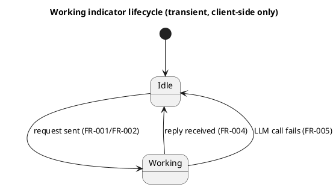

# Data Model: LLM Working Indicator for Conversational Authoring

No new or changed entities. This feature adds no server-side state: the working indicator
is a transient DOM element owned entirely by the page's existing synchronous JS control
flow (the same scope that already owns `sendButton.disabled`), never persisted, never sent
to or read from the server. See research.md's "No new server-side state" decision.

**Lifecycle** (client-side only, scoped to a single in-flight request):

The `Candidate Delta` and `Session` entities this package already owns are unchanged — see
`specs/EPIC-003-conversational-model-authoring/data-model.md`.
