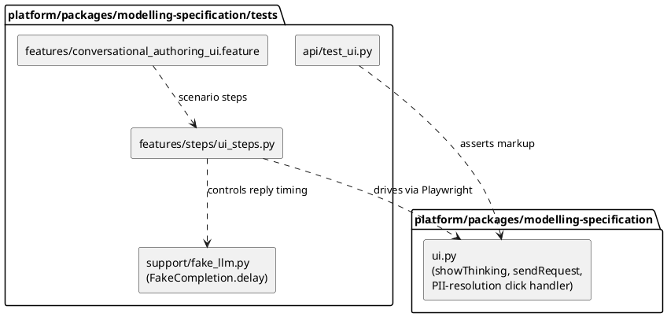

# Implementation Plan: LLM Working Indicator for Conversational Authoring

**Branch**: `feature/186-llm-working-indicator` | **Date**: 2026-11-08 | **Spec**: [spec.md](spec.md)

**Input**: Feature specification from `specs/EPIC-003-conversational-model-authoring/003-llm-working-indicator/spec.md`

## Summary

Add a visible "working" indicator to the conversational authoring chat (GH #186) for both
places the UI currently waits on the LLM with no feedback beyond the disabled Send button:
the initial `propose` call and the resubmission after a flagged PII/PHI match is resolved
(`propose/resolve-pii`). The indicator is a plain chat message, inserted the moment the
request is sent and removed — win, lose, or draw — the moment a reply or failure is ready.
No API, data model, or new package is needed: see research.md for why this stays inside
`ui.py` rather than becoming a new `platform/packages/<name>` shared package.

## Technical Context

**Language/Version**: Python 3.12 (existing FastAPI route, unchanged) + vanilla JS/CSS
embedded in `ui.py`'s `_PAGE` string — no new language or framework.

**Primary Dependencies**: None added. Reuses the existing `_PAGE_TEMPLATE`/`_PAGE` pattern
(no Jinja2, no static-asset pipeline, no JS framework/build step, per `ui.py`'s module
docstring).

**Storage**: N/A — no persisted or server-side state (research.md "No new server-side state").

**Testing**: `pytest`/`TestClient` for static-markup assertions (`tests/api/test_ui.py`);
`behave` + Playwright for the live in-browser interaction (`tests/features/
conversational_authoring_ui.feature`, `tests/features/steps/ui_steps.py`), with a new
injectable delay on the `FakeCompletion` test double (`tests/support/fake_llm.py`) so the
one scenario asserting the indicator's presence while in flight isn't racing an
effectively-instant fake LLM call.

**Target Platform**: Browser, served by the existing `modelling_specification.app` FastAPI
app — same target as the rest of the authoring UI.

**Project Type**: UI addition inside an existing web-service package
(`platform/packages/modelling-specification`).

**Performance Goals**: The indicator appears synchronously on click, with no network
round-trip needed to show it — well inside Principle IV's 200ms bar, since showing it adds
no I/O at all.

**Constraints**: No new runtime dependency; no API/contract change; must not change the
meaning Playwright's existing `.msg.agent` selector already has across ~15 scenarios in
`ui_steps.py` (the indicator is styled and classed so it is never matched by `.msg.agent`).

**Scale/Scope**: One source file (`ui.py`); one test-support file (`fake_llm.py`); one
pytest module and one behave feature/steps file extended; this plan's own doc set. No new
package, no new ADR (see Constitution Check).

## Constitution Check

*GATE: Must pass before Phase 0 research. Re-check after Phase 1 design.*

| Principle | Assessment |
|---|---|
| I. Code Quality | Two small, named JS functions (show/remove the indicator) plus one CSS rule; no new abstraction beyond what the existing `addMessage` helper already provides. Pass. |
| II. Testing Standards | New assertions in `test_ui.py` for the new markup; a new behave scenario drives the real, deterministic-delay-controlled in-flight state end-to-end, not just the final state. Pass. |
| III. UX Consistency | Reuses the existing chat/message visual language (`.msg` block, muted text) rather than inventing a second UI region or interaction pattern. Pass. |
| IV. Performance | Indicator shows before any network wait; no polling, no new round-trip. Pass. |
| V. Security Practices | Indicator text is a static literal, never interpolated from user or LLM input; no new endpoint or attack surface. Pass. |
| VI. State Management | No new state machine; the transient "a request is in flight" state is owned by the same synchronous click-handler scope that already owns `sendButton.disabled`, removed via the same `try`/`finally` blocks. Pass. |
| VII–IX | Not implicated — no model-accuracy, durability/interop, or cross-platform concern beyond ordinary browser behaviour already assumed elsewhere in this UI. N/A. |
| X. Decision Traceability | No new ADR. This is additive UI behaviour within a package whose shape ADR-0037 already settled; the issue's "shared platform functionality" framing is a suggestion, not a decision made here — it is deliberately deferred the same way GH #185's `markdown_render.py` was (documented in research.md), so there is no new cross-cutting decision to record. |
| XI. Concise Spec Artefacts | research.md/data-model.md/quickstart.md each state their point once and point back to spec.md or the parent epic's docs rather than restating them. |

No violations. Complexity Tracking table omitted (nothing to justify).

*Post-Phase-1 re-check*: unchanged — Phase 1 (below) introduced no new entities, contracts,
or dependencies that would shift any assessment above.

## Project Structure

### Documentation (this feature)

```text
specs/EPIC-003-conversational-model-authoring/003-llm-working-indicator/
├── plan.md              # This file
├── research.md          # Phase 0 output
├── data-model.md        # Phase 1 output (no new entities)
├── quickstart.md        # Phase 1 output
└── tasks.md             # Phase 2 output (/speckit-tasks — not yet created)
```

No `contracts/` directory: no API shape changes (see Summary). The parent epic's
`specs/EPIC-003-conversational-model-authoring/contracts/api.md` already documents
`propose` and `propose/resolve-pii` unchanged by this feature.

### Source Code (repository root)



**Structure Decision**: Everything lives inside the existing `modelling-specification`
package, in the one file (`ui.py`) that already owns the chat UI, plus its own test tree —
no new package, no new module. See research.md for why no shared package is extracted.

## Complexity Tracking

Not applicable — no Constitution Check violations.
