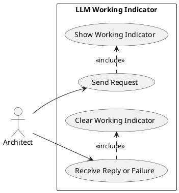
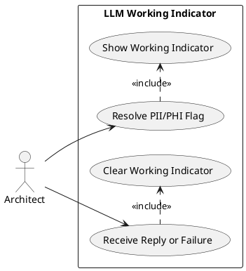

# Feature Specification: LLM Working Indicator for Conversational Authoring

**Feature Branch**: `feature/186-llm-working-indicator`

**Created**: 2026-11-08

**Status**: Draft

**Input**: User description: "Add a visible 'thinking'/working indicator to the modelling-specification conversational authoring chat UI, covering every path that waits on the LLM (propose, and propose/resolve-pii). GitHub issue #186. After sending a request in the chat UI there is no indication the LLM is working on a reply beyond the Send button being disabled -- an LLM call can take a while and the page looks idle/stuck. Need a visible indicator (e.g. a 'thinking' message in the chat) shown from the moment a request is sent until the reply arrives or the call fails, covering both the propose path and the propose/resolve-pii path (after a PII review). Streaming the reply is explicitly out of scope. The issue suggests this as platform functionality other LLM-backed UI packages could reuse rather than a one-page fix." (GH #186)

## User Scenarios & Testing *(mandatory)*

### Overall flow

An Enterprise Architect is using the conversational authoring chat to describe a change. Today, after they press Send, the only feedback is that the Send button becomes disabled; the chat itself shows nothing new until a reply or an error arrives, which can take long enough that the page looks stuck. This feature adds a visible, immediate indicator in the chat that the request is being worked on, for every path that waits on an LLM call, and clears it the moment a reply (success or failure) is ready.

### User Story 1 - See that a request is being worked on (Priority: P1)

An architect types a request and presses Send. A visible "working" indicator appears in the chat immediately, and stays visible for as long as the reply takes, so the architect never wonders whether the request went through.

**Why this priority**: This is the core complaint in GH #186 and the feature's entire reason to exist; without it, nothing changes.

**Independent Test**: Send a request, observe an indicator appears right away, and confirm it is replaced by the agent's reply once it arrives.

**Acceptance Scenarios**:

1. **Given** the architect has typed a request and the chat is idle, **When** they press Send, **Then** a visible working indicator appears in the chat before any reply is received.
2. **Given** the working indicator is visible, **When** the agent's reply (a message, a proposed delta, or a set of options) arrives, **Then** the indicator is removed and replaced by that reply.
3. **Given** the working indicator is visible, **When** the LLM call fails, **Then** the indicator is removed and replaced by an error message, exactly as an immediate failure would be shown today.
4. **Given** the working indicator is visible, **When** the architect looks at the Send control, **Then** it remains disabled, exactly as it is today, so a second request cannot be sent while one is already in flight.

---

### User Story 2 - See the same indicator after resolving a flagged PII/PHI match (Priority: P1)

A request the architect sent was flagged for containing PII/PHI and paused for review. After the architect resolves the flagged match (redact, allow, or edit and resubmit), the resolved request goes back to the LLM. This wait gets the same visible working indicator as an ordinary request, since from the architect's point of view it is the same kind of wait.

**Why this priority**: GH #186 calls this path out explicitly as a second place today's UI goes idle with no feedback; missing it would leave the complaint half-fixed.

**Independent Test**: Trigger a PII/PHI review, resolve it, and confirm the same working indicator appears for the resulting LLM call and clears the same way.

**Acceptance Scenarios**:

1. **Given** a request was flagged for PII/PHI review, **When** the architect resolves it (redact, allow, or edit and resubmit), **Then** a visible working indicator appears in the chat before the resolved request's reply arrives.
2. **Given** that indicator is visible, **When** the resolved request's reply or failure arrives, **Then** it is removed and replaced exactly as in User Story 1.

---

### Edge Cases

- What happens if the architect presses Send again while the indicator is showing? Nothing — the Send control stays disabled while a request is in flight, as it does today; this feature does not change that guard.
- What happens if the reply that arrives is a clarifying message, a proposed delta, or a set of suggested options (ADR-0041)? The indicator is removed the same way regardless of which of these the reply turns out to be — the architect never sees it try to "guess" a kind before the reply is known.
- What happens for chat actions that do not call the LLM (choosing a suggested option, applying/rejecting a delta, picking a view)? No working indicator appears for these — the indicator is scoped to the two interactions the issue identifies: the initial proposal and the post-PII-review resubmission.
- What happens if the architect's request errors out synchronously (e.g. validation fails before any call is made)? No indicator is needed, and none appears, since no wait occurred.

## Requirements *(mandatory)*

### Functional Requirements

- **FR-001**: The chat UI MUST show a visible working indicator the moment the architect sends a request, before any reply has been received.
- **FR-002**: The working indicator MUST stay visible for the entire time the system is waiting on the LLM call, with no gap between the indicator appearing and the request actually being sent.
- **FR-003**: The working indicator MUST appear for the initial proposal request (`propose`) and for the resubmission after a flagged PII/PHI match is resolved (`propose/resolve-pii`); no other chat action requires it.
- **FR-004**: When a reply arrives — whether a clarifying message, a proposed delta, or a set of suggested options — the working indicator MUST be removed and replaced by that reply, without a stale indicator persisting alongside it.
- **FR-005**: When the LLM call fails, the working indicator MUST be removed and replaced by the error message the chat shows today.
- **FR-006**: The Send control MUST remain disabled for the same duration the indicator is visible, preserving today's guard against sending a second request while one is in flight.
- **FR-007**: The working indicator MUST NOT alter the content, order, or visibility of any earlier chat message, and MUST NOT affect the render/preview pane.

## Success Criteria *(mandatory)*

### Measurable Outcomes

- **SC-001**: After pressing Send, an architect sees visible feedback that their request is being worked on with no perceptible delay, every time, for both the initial request and a post-PII-review resubmission.
- **SC-002**: 100% of chat replies and failures, across both LLM-calling paths, are preceded by a visible working indicator that covers the entire wait with no gap.
- **SC-003**: An architect watching the chat during a slow reply can tell, at any point before the reply arrives, that the system is still working rather than stuck or finished silently.

## Assumptions

- Streaming the reply as it is generated is out of scope, per the issue's own framing of it as a larger alternative; the indicator communicates "working", not incremental progress.
- The exact visual form of the indicator (e.g. a "Thinking…" chat message vs. an animated element) is an implementation detail left to planning; the issue's own example ("a 'thinking' message in the chat") is a reasonable default.
- The indicator is unconditional — it needs no new setting or configuration surface.
- The implementation is written as a small, self-contained unit that another LLM-backed UI package could reuse as-is, following this package's existing `markdown_render.render_message_markdown` precedent (GH #185) of writing shared-shaped code in the consuming package without yet extracting a new `platform/packages/<name>` shared package. No second package is wired up to it in this change: `controls-compliance-catalog`'s playground already has its own independently-built working indicator (a "converting…" status dot) for its own LLM-backed call, and nothing in this change requires touching it.
