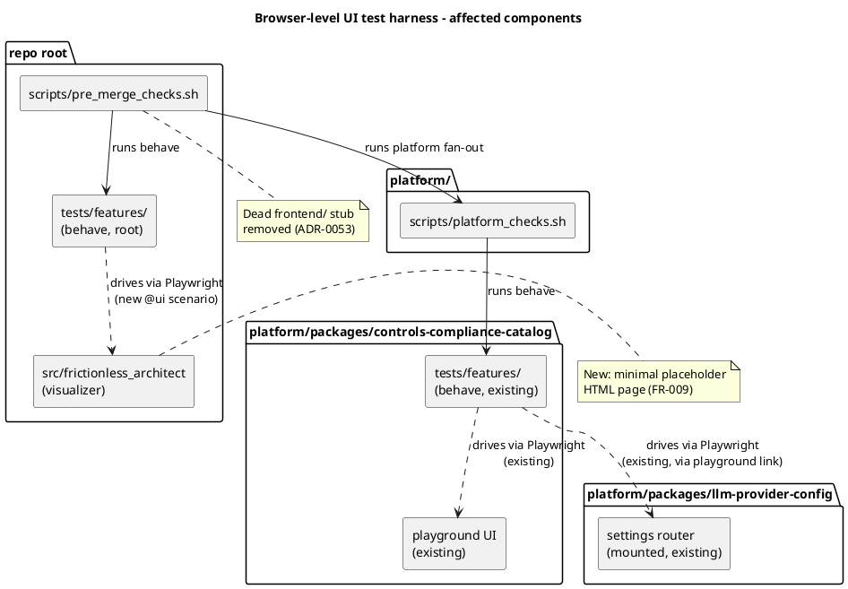
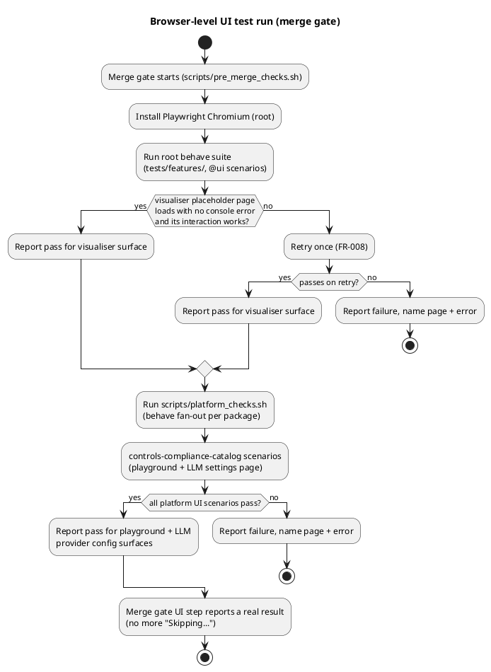
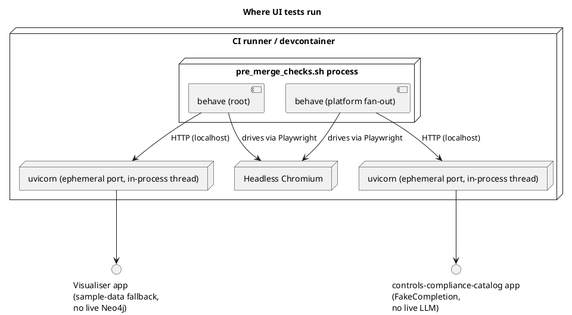

# Implementation Plan: Browser-Level Tests for the HTML UIs

**Branch**: `feature/gh-119-playwright-ui-tests` | **Date**: 2026-11-14 | **Spec**: [spec.md](spec.md)

**Input**: Feature specification from `specs/EPIC-004-playwright-ui-tests/spec.md`

## Summary

Give all three HTML UI surfaces named in GH #119 real browser-level smoke coverage, gated by
the merge gate and excluded from the fast gate. Research found two of the three surfaces
(the control conversion playground, the LLM provider config page) already have this, via a
`behave` + plain Playwright harness already shipped in
`platform/packages/controls-compliance-catalog/tests/features/` and mirrored in
`platform/packages/modelling-specification`. This plan extends that same pattern rather than
adding the issue's originally proposed `pytest-playwright` as a second toolchain (ADR-0053),
adds the same live-server + Playwright capability to the root `tests/features/` harness and
a minimal placeholder page to the visualiser, which previously served only a JSON API (see
research.md), and deletes the dead `frontend/` stub from `scripts/pre_merge_checks.sh` since
`scripts/platform_checks.sh` and the pre-existing root `behave` step already gate the real
work.

## Technical Context

**Language/Version**: Python 3.12 (project floor `>=3.11,<3.14`)

**Primary Dependencies**: FastAPI, uvicorn, `behave`, `playwright` (plain, sync API — not
`pytest-playwright`; see ADR-0053), `httpx`/`pytest` for the existing non-UI suites

**Storage**: N/A — no new persisted state; the visualiser's placeholder page reads the
existing `/schema-payload` JSON API, itself backed by Neo4j or the committed sample model

**Testing**: `behave` scenarios tagged `@ui`, run against a live `uvicorn` instance of each
surface's real FastAPI app, driven by a `playwright` Chromium browser; deterministic stand-ins
for external dependencies (`FakeCompletion` for the LLM, the visualiser's existing
sample-data fallback for Neo4j)

**Target Platform**: Linux server (the devcontainer and CI runner); tests run headless Chromium

**Project Type**: Web service (FastAPI, server-rendered HTML) — root `src/frictionless_architect/`
plus three `platform/packages/*`

**Performance Goals**: N/A — this feature adds test infrastructure, not a runtime capability;
SC-005 requires the fast gate's runtime to stay unaffected (no browser tests run there)

**Constraints**: One retry on a failing browser-level test before the merge gate reports
failure (FR-008, Clarifications); browser-level tests never run against the fast gate
(FR-005); Chromium only, per the harness this plan reuses

**Scale/Scope**: 3 UI surfaces, each with at least one smoke-coverage scenario (page loads with
no console error; main interaction gives the expected DOM result)

## Constitution Check

*GATE: Must pass before Phase 0 research. Re-check after Phase 1 design.*

- **Principle I (Code Quality / DRY)**: PASS. Reusing the existing `behave`+Playwright pattern
  instead of adding a parallel `pytest-playwright` harness is the DRY-compliant choice; see
  ADR-0053.
- **Principle II (Testing Standards)**: PASS. New browser-level tests are themselves tests;
  they sit outside the 90% line-coverage gate (that gate measures `src`/`architecture/model`,
  not UI scenario counts) and don't lower it.
- **Principle IV (Performance)**: PASS. SC-005 keeps the fast gate's runtime unaffected; the
  merge gate absorbs the new runtime cost, consistent with existing `behave`/Snyk placement.
- **Principle VII (System Integrity & Accuracy)**: PASS, informed the retry-policy
  clarification (FR-008) — fail-fast-with-one-retry, not silent masking, per the Session
  2026-11-14 answer.
- **Principle IX (Cross-Platform Consistency)**: PASS. Chromium-only matches the existing
  shipped harness; no new cross-browser matrix is introduced or implied.
- **Principle X (Decision Traceability)**: PASS. ADR-0053 (Accepted) records the harness-reuse
  and placeholder-page decisions in the same change set. See "Model impact" below for the
  reasoned model-impact statement Principle X requires.
- **Principle XI (Concise Spec Artefacts)**: PASS. This plan links to `spec.md` and
  `data-model.md` rather than restating their content; diagrams are drawn once, here and in
  `spec.md`'s per-user-story use-case diagrams.

No violations requiring Complexity Tracking.

### Model impact

**None** — no `architecture/model/` element, relationship, or view is added, changed, or
retired. This is a reasoned conclusion, not a default, checked against the two rules that
could have required an addition:

- **ADR-0044's Technology-layer threshold** (a runtime dependency gets its own
  `SystemSoftware` element when it's in `pyproject.toml`'s main `dependencies` list *and*
  either backs a distinctive, named capability or was chosen by its own ADR's Decision
  section). `playwright` fails the gate on scope alone: ADR-0044 explicitly excludes the
  `dev`/`tests`/`lint`/`docs` groups, and `playwright` is added to the `tests` group — the
  same group `pytest` itself sits in. `sw-pytest` is modelled not because it is a test
  runner, but because it hosts `techproc-oscal-golden-check`, a `TechnologyProcess` with
  named `Access` relationships to specific modelled `DataObject`s (the golden-dataset
  baselines). This feature's `@ui` scenarios have no analogous relationship to a modelled
  `DataObject` — they are a generic rendering/interaction smoke check, not a distinctive
  capability tied to a named model element, so no `TechnologyProcess` is warranted either.
- **The visualiser placeholder page** (FR-009) is a capability of the already-modelled
  `sub-schema-visualizer` `ApplicationComponent` (context `schema-visualizer-api`), not a
  new one — and it is deliberately throwaway (ADR-0053: "not meant to accrete features",
  superseded once GH #74 ships). The real UI composition work GH #74 tracks is already
  represented in the model as `gap-neo4j-schema-ui`; that Gap, not this placeholder, is
  where a future `ApplicationFunction`/view addition belongs. Modelling the placeholder now
  would add an element only to retire it again once GH #74 lands.

## Project Structure

### Documentation (this feature)

```text
specs/EPIC-004-playwright-ui-tests/
├── plan.md              # This file (/speckit-plan command output)
├── research.md          # Phase 0 output (/speckit-plan command)
├── data-model.md        # Phase 1 output (/speckit-plan command)
├── quickstart.md        # Phase 1 output (/speckit-plan command)
├── contracts/           # Phase 1 output (/speckit-plan command)
└── tasks.md             # Phase 2 output (/speckit-tasks command - NOT created by /speckit-plan)
```

### Source Code (repository root)



**Structure Decision**: No new top-level directories. The visualiser gets one new module
(placeholder page route) under `src/frictionless_architect/visualizer/`; root
`tests/features/` gains an `@ui`-tagged feature file plus an extension to the existing
`environment.py` (conditional live-server + Playwright setup, mirroring
`controls-compliance-catalog`'s `environment.py`); `scripts/pre_merge_checks.sh` loses its
dead `frontend/` block and gains a `playwright install chromium` step before the existing
root `behave` call; root `pyproject.toml`'s `tests` dependency group gains `playwright`. No
changes are needed in `platform/packages/controls-compliance-catalog` or
`platform/packages/modelling-specification` — their existing coverage already satisfies
FR-001/FR-002 for the playground and LLM provider config page.

### Process flow



### Deployment



## Complexity Tracking

> No Constitution Check violations — this section is intentionally empty.
