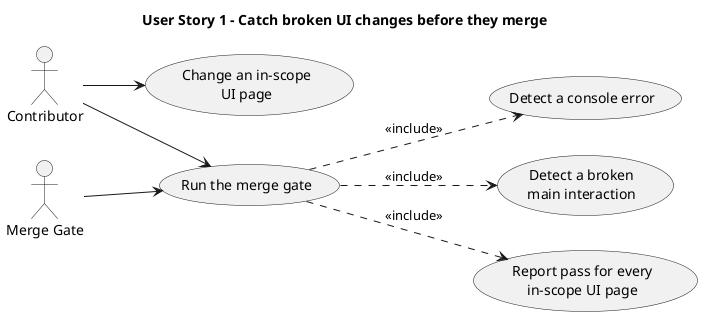
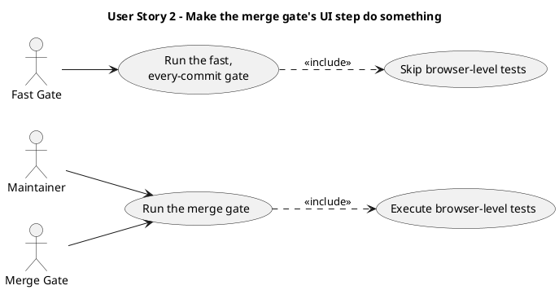
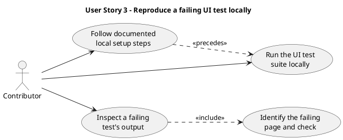

# Feature Specification: Browser-Level Tests for the HTML UIs

**Feature Branch**: `feature/gh-119-playwright-ui-tests`

**Created**: 2026-11-14

**Status**: Draft

**Input**: GH issue #119 ("test(ui): establish Playwright browser tests for the HTML UIs") and its comments.

## Clarifications

### Session 2026-11-14

- Q: When a browser-level test fails, should the test runner automatically retry it before the merge gate reports a failure, or should every failure be reported on the first attempt? → A: One automatic retry on failure before reporting (Option B) — reduces flaky false positives at some risk of masking an intermittent real bug.
- Q: The visualiser currently serves no HTML page (only a JSON API; its UI composition/build tooling is tracked separately, still open, in GH #74) — how should this feature treat that third surface? → A: Build a minimal placeholder HTML page for the visualiser as part of this feature, so there is a real page to test.
- Q: The playground and LLM provider config page already have working, committed `behave` + Playwright browser-test coverage, already excluded from the fast gate and already run by the merge gate. Should this feature extend that existing pattern, or add the issue's originally proposed `pytest-playwright` harness as a second toolchain? → A: Extend the existing `behave` + Playwright pattern; no second toolchain.

## User Scenarios & Testing *(mandatory)*

### User Story 1 - Catch broken UI changes before they merge (Priority: P1)

A contributor changes the markup or client-side script of one of the platform's
server-rendered HTML UIs. Today, nothing exercises the page in a real browser, so a
change that loads the page with console errors, or breaks its main interaction, can
reach `main` undetected — existing tests only check the raw HTML payload, never the
rendered page or its scripts.

**Why this priority**: This is the problem statement itself. Without it, the other
stories have nothing to run.

**Independent Test**: Deliberately break a UI's main interaction (e.g. disable a
button's click handler) on a branch, run the merge gate, and confirm it fails. Revert
the breakage and confirm the gate passes.

**Acceptance Scenarios**:

1. **Given** a change that introduces a JavaScript console error on one of the
   in-scope UI pages, **When** the merge gate runs, **Then** it fails and names the
   page and the error.
2. **Given** a change that breaks the main interaction of one of the in-scope UI
   pages (e.g. a conversion button stops updating its output), **When** the merge
   gate runs, **Then** it fails and names the broken interaction.
3. **Given** no UI regression, **When** the merge gate runs, **Then** it passes and
   reports a result for every in-scope UI page, not just a subset.

---

### User Story 2 - Make the merge gate's UI step do something (Priority: P2)

The merge gate already has a "frontend UI harness" step, but it is a dead stub: it
checks for a `frontend/` directory that was never created, prints "Skipping…", and
always passes. A maintainer merging a UI change today gets a green check that means
nothing.

**Why this priority**: Story 1's protection only has teeth if it actually runs in the
gate contributors and maintainers rely on; this story turns the existing no-op step
into a real one.

**Independent Test**: Run the merge gate on a clean branch and confirm the UI step
executes real checks and reports a pass/fail result, rather than printing
"Skipping…".

**Acceptance Scenarios**:

1. **Given** the merge gate runs on any branch, **When** it reaches the UI test
   step, **Then** it executes the browser-level tests rather than skipping them.
2. **Given** the fast, every-commit gate runs, **When** it completes, **Then** it has
   not run any browser-level test (those stay in the slower, pre-merge gate only).

---

### User Story 3 - Reproduce a failing UI test locally (Priority: P3)

A contributor sees a browser-level test fail in the merge gate and needs to
reproduce and debug it on their own machine, including any one-time setup their
environment doesn't already have.

**Why this priority**: Valuable once the tests exist and are gating merges, but
there's nothing to document or debug until Stories 1 and 2 are in place.

**Independent Test**: Follow only the documented steps on a machine that has never
run these tests before, and confirm the full UI test suite runs to completion
locally.

**Acceptance Scenarios**:

1. **Given** a contributor has never run the UI tests before, **When** they follow
   the documented local setup and run steps, **Then** the suite runs to completion
   without undocumented manual steps.
2. **Given** a UI test fails locally, **When** the contributor inspects the test
   run's output, **Then** it identifies which UI page and which check failed.

---

### Edge Cases

- What happens when a UI surface's backend normally depends on a live external
  service (an LLM provider, the Neo4j cluster) that isn't available where the tests
  run? The tests must exercise the page against a deterministic stand-in for that
  dependency, not the live service.
- How does a test behave when a page never reaches the expected state (e.g. broken
  JavaScript leaves an element stuck loading)? It must fail with a clear, bounded-time
  error rather than hanging indefinitely.
- What happens when a UI surface is added later that isn't one of the three listed in
  scope? Out of scope for this feature — covering a future UI surface is separate,
  follow-on work.

## Requirements *(mandatory)*

### Functional Requirements

- **FR-001**: The system MUST provide an automated browser-level test for each of the
  three in-scope UI surfaces — the control-conversion playground, the LLM provider
  config page, and the visualiser UI — that verifies the page loads without a
  JavaScript console error.
- **FR-002**: The system MUST provide an automated browser-level test for each
  in-scope UI surface's main interaction, verifying it produces the expected result in
  the page (for example, the playground's convert action fills in both output panes).
- **FR-003**: Browser-level tests MUST run against a live instance of each UI's
  application rather than a static HTML fixture, so the tests exercise the real
  page's scripts.
- **FR-004**: Browser-level tests MUST exercise each UI surface's backend against a
  deterministic stand-in dependency where that backend would otherwise need a live
  external service (an LLM provider, the Neo4j cluster), so tests are reproducible
  without those services being available.
- **FR-005**: Browser-level tests MUST be excluded from the fast, every-commit gate
  and MUST run as part of the pre-merge gate.
- **FR-006**: The merge gate's existing UI test step MUST execute the browser-level
  tests instead of unconditionally reporting a skip.
- **FR-007**: The project's testing documentation MUST describe how to set up and run
  the browser-level tests locally, including any one-time environment setup a
  contributor's machine would otherwise be missing.
- **FR-008**: A browser-level test that fails MUST be automatically retried exactly
  once before the merge gate reports it as a failure; a test that fails twice in a row
  MUST be reported as a real failure, not silently retried further.
- **FR-009**: Because the visualiser currently serves no HTML page, the system MUST add
  a minimal placeholder HTML page for it, so FR-001 and FR-002's browser-level smoke
  coverage has a real page to exercise.

## Success Criteria *(mandatory)*

### Measurable Outcomes

- **SC-001**: All three in-scope UI surfaces have at least one passing automated
  browser-level test.
- **SC-002**: A deliberately broken UI interaction, introduced on a branch as a
  verification check, is caught by the merge gate before that branch could be merged.
- **SC-003**: The merge gate's UI test step reports a real pass/fail result on every
  run, with zero runs reporting "skipped" going forward.
- **SC-004**: A contributor who has never run the UI tests before can get the full
  suite running locally using only the written documentation, with no undocumented
  manual step.
- **SC-005**: The fast, every-commit gate's typical runtime is unaffected by this
  feature, because it runs none of the new browser-level tests.

## Assumptions

- The in-scope UI surfaces are exactly the three named in GH issue #119: the control
  conversion playground, the LLM provider config page, and the visualiser UI. Any
  other HTML UI the platform serves is out of scope for this feature.
- "No console errors" and "the main interaction gives the expected result" are
  sufficient smoke coverage for each in-scope surface for this feature; deeper
  per-surface UI test coverage is follow-on work, not required here.
- A UI surface's live-server test target may be either a single shared host process
  that mounts multiple surfaces, or each surface's own standalone application entry
  point — whichever this feature's design settles on is a planning decision, not a
  constraint this spec imposes.
- Running the new tests as a separate CI job (versus inside the existing pre-merge
  gate script) is optional and out of scope for this feature; the pre-merge gate is
  sufficient to satisfy the success criteria above.
- Which specific tooling implements these tests, and any load-bearing choice between
  candidate approaches, is recorded as an ADR during planning, per the project's
  decision-traceability principle — not decided in this spec.
- The visualiser's placeholder page (FR-009) is a minimal landing page sufficient for
  smoke testing only. It is not the subsystem UI composition work tracked separately
  in GH #74, which remains unblocked, separate, follow-on work.
